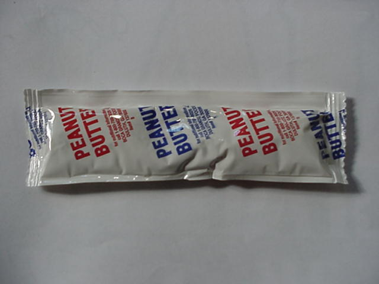
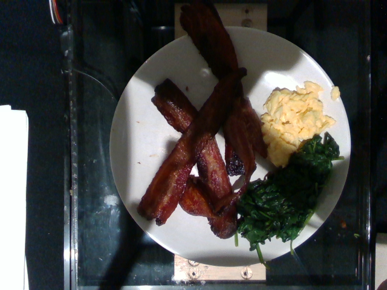
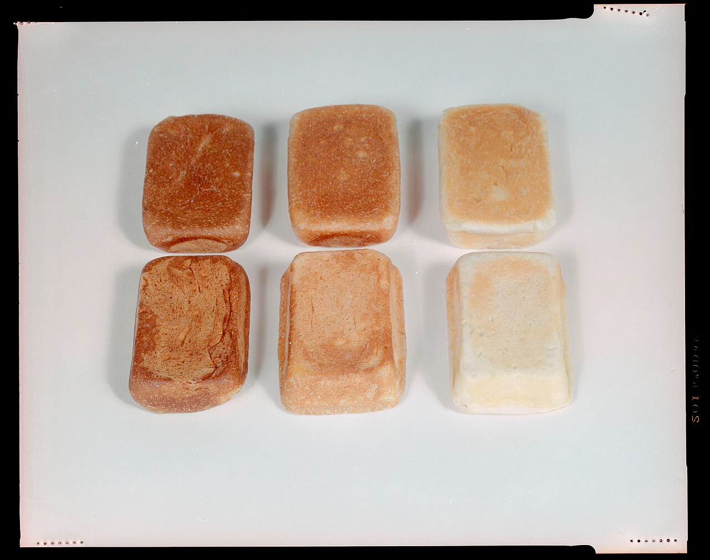
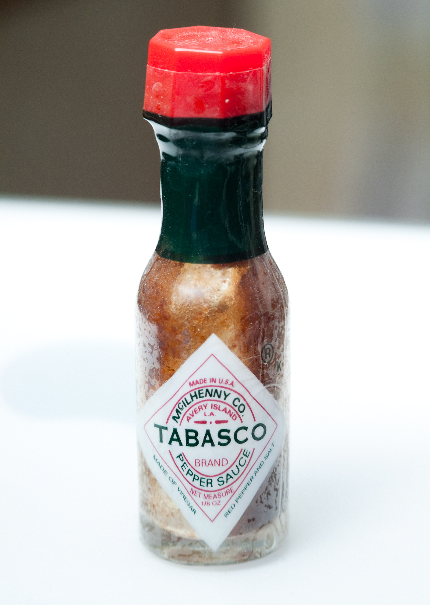

# Galeria propozycji referencji E7-R — osoba 2

**NOT-RUNNABLE · HUMAN_REVIEW_PENDING · O3_CONFIGURATION_PENDING**

35 dokładnych oryginałów obejrzanych przez O2;30 propozycji (8/8/10/4),4 odrzucenia,1 nierozstrzygnięty. Human qualified/zgody/uploads=0. To propozycje LLM, nie referencje człowieka lub pomiar Gemini.

[Propozycje](reference_proposals.json) · [indeks pierwotny](candidate_index.json) · [nowe źródła](commons/replacement-index.json) · [uzupełnienie Commons](commons/completion-index.json) · [nowa anotacja](nutrition5k/completion-annotations.json) · [atrybucja](commons/ATTRIBUTION.md) · [raport](../../docs/e7/RAPORT_PRZYGOTOWANIA_ZDJEC.md)

Wyjątki: n5-10 agregat bulw; n5-14 częściowo zasłonięty brokuł; n5-16 unresolved; commons-03/07/08/20 rejected; commons-19 proposed zamiast commons-08; commons-10 alternatywne przykłady, bez sumowania; commons-15–18 jeden mechanizm zasłonięcia.

### n5-01 — products — PROPOSED

SHA-256: `8f444e62ec0d5473c7279380e351c3ee1e98a059f96b1a8bc19233ea49e37e42`

**Widoczność:** Całe czerwone jabłko na talerzu.

**Propozycja składników → aliasy:** apple → apple, jabłko

**Decyzja/niepewność:** Widoczny główny składnik zgodny z dokładną anotacją źródła; bez wnioskowania marki/masy/makr.

[Źródło obrazu](https://storage.googleapis.com/nutrition5k_dataset/nutrition5k_dataset/imagery/realsense_overhead/dish_1558723777/rgb.png) · CC BY 4.0 · Nutrition5k — Thames, Karpur, Norris, Xia, Panait, Weyand, Sim; CVPR 2021; CC BY 4.0; unchanged RGB

[Dowód składników](nutrition5k/annotations.json) · locator: `dish_1558723777` · original_dataset_annotation

**Zatwierdzenia:** human_reference=null, provider_consent=null, nonsensitive_approval=null; reviewer/reviewed_at=null.

### n5-02 — products — PROPOSED

SHA-256: `760cd1881bfbd5b5a3e506ecb8c73f593f81f0cf0f695cda6d50abfb4da92a68`

**Widoczność:** Brązowe migdały, wyraźny kształt.

**Propozycja składników → aliasy:** almonds → almonds, migdały

**Decyzja/niepewność:** Widoczny główny składnik zgodny z dokładną anotacją źródła; bez wnioskowania marki/masy/makr.

[Źródło obrazu](https://storage.googleapis.com/nutrition5k_dataset/nutrition5k_dataset/imagery/realsense_overhead/dish_1558637393/rgb.png) · CC BY 4.0 · Nutrition5k — Thames, Karpur, Norris, Xia, Panait, Weyand, Sim; CVPR 2021; CC BY 4.0; unchanged RGB

[Dowód składników](nutrition5k/annotations.json) · locator: `dish_1558637393` · original_dataset_annotation

**Zatwierdzenia:** human_reference=null, provider_consent=null, nonsensitive_approval=null; reviewer/reviewed_at=null.

### n5-03 — products — PROPOSED

SHA-256: `5191267eec40a52ae44396abd66d210f9e65d7207aad36647e171e3282f2ee5b`

**Widoczność:** Żółte kawałki jajecznicy; bez dodatkowej receptury.

**Propozycja składników → aliasy:** scrambled eggs → scrambled eggs, jajecznica

**Decyzja/niepewność:** Widoczny główny składnik zgodny z dokładną anotacją źródła; bez wnioskowania marki/masy/makr.

[Źródło obrazu](https://storage.googleapis.com/nutrition5k_dataset/nutrition5k_dataset/imagery/realsense_overhead/dish_1562862493/rgb.png) · CC BY 4.0 · Nutrition5k — Thames, Karpur, Norris, Xia, Panait, Weyand, Sim; CVPR 2021; CC BY 4.0; unchanged RGB

[Dowód składników](nutrition5k/annotations.json) · locator: `dish_1562862493` · original_dataset_annotation

**Zatwierdzenia:** human_reference=null, provider_consent=null, nonsensitive_approval=null; reviewer/reviewed_at=null.

### n5-04 — products — PROPOSED

SHA-256: `7796c554e2dd169345dde9175fdbaa6edd56c4336593bcca9b2d683ff06b6feb`

**Widoczność:** Biały ugotowany ryż w miseczce.

**Propozycja składników → aliasy:** white rice → white rice, biały ryż, ryż

**Decyzja/niepewność:** Widoczny główny składnik zgodny z dokładną anotacją źródła; bez wnioskowania marki/masy/makr.

[Źródło obrazu](https://storage.googleapis.com/nutrition5k_dataset/nutrition5k_dataset/imagery/realsense_overhead/dish_1558459276/rgb.png) · CC BY 4.0 · Nutrition5k — Thames, Karpur, Norris, Xia, Panait, Weyand, Sim; CVPR 2021; CC BY 4.0; unchanged RGB

[Dowód składników](nutrition5k/annotations.json) · locator: `dish_1558459276` · original_dataset_annotation

**Zatwierdzenia:** human_reference=null, provider_consent=null, nonsensitive_approval=null; reviewer/reviewed_at=null.

### n5-05 — products — PROPOSED

SHA-256: `ef5de9319132d0b57c8e85872229168f85d2e57abe11cae33f97c0fd244410d9`

**Widoczność:** Zielone różyczki brokułu.

**Propozycja składników → aliasy:** broccoli → broccoli, brokuł, brokuły

**Decyzja/niepewność:** Widoczny główny składnik zgodny z dokładną anotacją źródła; bez wnioskowania marki/masy/makr.

[Źródło obrazu](https://storage.googleapis.com/nutrition5k_dataset/nutrition5k_dataset/imagery/realsense_overhead/dish_1558725253/rgb.png) · CC BY 4.0 · Nutrition5k — Thames, Karpur, Norris, Xia, Panait, Weyand, Sim; CVPR 2021; CC BY 4.0; unchanged RGB

[Dowód składników](nutrition5k/annotations.json) · locator: `dish_1558725253` · original_dataset_annotation

**Zatwierdzenia:** human_reference=null, provider_consent=null, nonsensitive_approval=null; reviewer/reviewed_at=null.

### n5-06 — products — PROPOSED

SHA-256: `377af4bd1ba20f9cf4cc0f916bbbad546abfe1a3781f41dd28d744f822646324`

**Widoczność:** Pomarańczowe plasterki marchwi.

**Propozycja składników → aliasy:** carrot → carrot, marchew, marchewka

**Decyzja/niepewność:** Widoczny główny składnik zgodny z dokładną anotacją źródła; bez wnioskowania marki/masy/makr.

[Źródło obrazu](https://storage.googleapis.com/nutrition5k_dataset/nutrition5k_dataset/imagery/realsense_overhead/dish_1558642089/rgb.png) · CC BY 4.0 · Nutrition5k — Thames, Karpur, Norris, Xia, Panait, Weyand, Sim; CVPR 2021; CC BY 4.0; unchanged RGB

[Dowód składników](nutrition5k/annotations.json) · locator: `dish_1558642089` · original_dataset_annotation

**Zatwierdzenia:** human_reference=null, provider_consent=null, nonsensitive_approval=null; reviewer/reviewed_at=null.

### n5-07 — products — PROPOSED

SHA-256: `a6e5e933536e75c625a74bfb6c31b65aa2d606e412b3f1ce369c4c7256581751`

**Widoczność:** Jasne różyczki kalafiora; światło słabsze, kształt widoczny.

**Propozycja składników → aliasy:** cauliflower → cauliflower, kalafior

**Decyzja/niepewność:** Widoczny główny składnik zgodny z dokładną anotacją źródła; bez wnioskowania marki/masy/makr.

[Źródło obrazu](https://storage.googleapis.com/nutrition5k_dataset/nutrition5k_dataset/imagery/realsense_overhead/dish_1558457530/rgb.png) · CC BY 4.0 · Nutrition5k — Thames, Karpur, Norris, Xia, Panait, Weyand, Sim; CVPR 2021; CC BY 4.0; unchanged RGB

[Dowód składników](nutrition5k/annotations.json) · locator: `dish_1558457530` · original_dataset_annotation

**Zatwierdzenia:** human_reference=null, provider_consent=null, nonsensitive_approval=null; reviewer/reviewed_at=null.

### n5-08 — products — PROPOSED

SHA-256: `735ceafe7e6c0c8339cb44bc65c7dc139cdb6ca474a2019755b7c8e33ae53381`

**Widoczność:** Czerwone małe pomidory.

**Propozycja składników → aliasy:** cherry tomatoes → cherry tomatoes, pomidorki koktajlowe, pomidory koktajlowe

**Decyzja/niepewność:** Widoczny główny składnik zgodny z dokładną anotacją źródła; bez wnioskowania marki/masy/makr.

[Źródło obrazu](https://storage.googleapis.com/nutrition5k_dataset/nutrition5k_dataset/imagery/realsense_overhead/dish_1558549008/rgb.png) · CC BY 4.0 · Nutrition5k — Thames, Karpur, Norris, Xia, Panait, Weyand, Sim; CVPR 2021; CC BY 4.0; unchanged RGB

[Dowód składników](nutrition5k/annotations.json) · locator: `dish_1558549008` · original_dataset_annotation

**Zatwierdzenia:** human_reference=null, provider_consent=null, nonsensitive_approval=null; reviewer/reviewed_at=null.

### n5-09 — mixed — PROPOSED

SHA-256: `c43f6a4176dc56b921b4a7c106d8bf780a0dfd8810777c3a6892dc70be9c68b7`

**Widoczność:** Pomidory, plasterki ogórka i tarta marchew.

**Propozycja składników → aliasy:** cherry tomatoes → cherry tomatoes, pomidorki koktajlowe; cucumbers → cucumbers, ogórek, ogórki; carrot → carrot, marchew, marchewka

**Decyzja/niepewność:** Widoczny główny składnik zgodny z dokładną anotacją źródła; bez wnioskowania marki/masy/makr.

[Źródło obrazu](https://storage.googleapis.com/nutrition5k_dataset/nutrition5k_dataset/imagery/realsense_overhead/dish_1560455030/rgb.png) · CC BY 4.0 · Nutrition5k — Thames, Karpur, Norris, Xia, Panait, Weyand, Sim; CVPR 2021; CC BY 4.0; unchanged RGB

[Dowód składników](nutrition5k/annotations.json) · locator: `dish_1560455030` · original_dataset_annotation

**Zatwierdzenia:** human_reference=null, provider_consent=null, nonsensitive_approval=null; reviewer/reviewed_at=null.

### n5-10 — mixed — PROPOSED

SHA-256: `1215171aa64c9781b3bf8b83c9e18b083411ec6eca68653f0afa3a692201e24f`

**Widoczność:** Żółte i białe jajka, winogrona oraz pomarańczowe bulwy.

**Propozycja składników → aliasy:** scrambled eggs → scrambled eggs, jajecznica; egg whites → egg whites, białka jaj, białka jajek; grapes → grapes, winogrona; orange tubers → orange tubers, bataty i pochrzyn, sweet potato and yam

**Decyzja/niepewność:** Anotacja rozróżnia yam i sweet potato, lecz obraz nie rozstrzyga ich osobno. Proponowany agregat orange tubers wymaga jawnej ludzkiej decyzji o granularity; aliasy nie uznają samego batata za oba gatunki. Olej pominięty.

[Źródło obrazu](https://storage.googleapis.com/nutrition5k_dataset/nutrition5k_dataset/imagery/realsense_overhead/dish_1563207364/rgb.png) · CC BY 4.0 · Nutrition5k — Thames, Karpur, Norris, Xia, Panait, Weyand, Sim; CVPR 2021; CC BY 4.0; unchanged RGB

[Dowód składników](nutrition5k/annotations.json) · locator: `dish_1563207364` · original_dataset_annotation

**Zatwierdzenia:** human_reference=null, provider_consent=null, nonsensitive_approval=null; reviewer/reviewed_at=null.

### n5-11 — mixed — PROPOSED

SHA-256: `922ac39525856b250a80751870e718e05c1212f2ac9c0033652ce56ad3d8857b`

**Widoczność:** Fioletowoskóre kawałki bakłażana, ziemniaki i kalafior.

**Propozycja składników → aliasy:** eggplant → eggplant, bakłażan; roasted potatoes → roasted potatoes, pieczone ziemniaki; cauliflower → cauliflower, kalafior

**Decyzja/niepewność:** Niewidoczne sól i oliwa pominięte. Drobne pomarańczowe pasma nie mają udokumentowanej tożsamości, nie dodano marchwi do referencji.

[Źródło obrazu](https://storage.googleapis.com/nutrition5k_dataset/nutrition5k_dataset/imagery/realsense_overhead/dish_1561575474/rgb.png) · CC BY 4.0 · Nutrition5k — Thames, Karpur, Norris, Xia, Panait, Weyand, Sim; CVPR 2021; CC BY 4.0; unchanged RGB

[Dowód składników](nutrition5k/annotations.json) · locator: `dish_1561575474` · original_dataset_annotation

**Zatwierdzenia:** human_reference=null, provider_consent=null, nonsensitive_approval=null; reviewer/reviewed_at=null.

### n5-12 — mixed — PROPOSED

SHA-256: `01a3f22ea7c045147ceb5ab15c1ed9fc33618835cf5bd295cec8c98d0161df92`

**Widoczność:** Białka jaj, tarte ziemniaki, owoce jagodowe i pomarańczowe bataty.

**Propozycja składników → aliasy:** egg whites → egg whites, białka jaj, białka jajek; hash browns → hash browns, tarte smażone ziemniaki; berries → berries, owoce jagodowe; sweet potato → sweet potato, batat, bataty

**Decyzja/niepewność:** Berries jest zbiorczą etykietą źródła; nie wymuszamy gatunków z samego obrazu.

[Źródło obrazu](https://storage.googleapis.com/nutrition5k_dataset/nutrition5k_dataset/imagery/realsense_overhead/dish_1561739238/rgb.png) · CC BY 4.0 · Nutrition5k — Thames, Karpur, Norris, Xia, Panait, Weyand, Sim; CVPR 2021; CC BY 4.0; unchanged RGB

[Dowód składników](nutrition5k/annotations.json) · locator: `dish_1561739238` · original_dataset_annotation

**Zatwierdzenia:** human_reference=null, provider_consent=null, nonsensitive_approval=null; reviewer/reviewed_at=null.

### n5-13 — mixed — PROPOSED

SHA-256: `3db9f973fb79d36d060a9c218bd83d3f91c9ab7f55dda87f6ec21faf34f91970`

**Widoczność:** Jajecznica, ziemniaki, brokuły, ananas oraz truskawki i ciemne owoce.

**Propozycja składników → aliasy:** berries → berries, owoce jagodowe; pineapple → pineapple, ananas; scrambled eggs → scrambled eggs, jajecznica; roasted potatoes → roasted potatoes, pieczone ziemniaki; broccoli → broccoli, brokuł, brokuły

**Decyzja/niepewność:** Berries pozostaje agregatem źródłowym; niewidoczna oliwa pominięta.

[Źródło obrazu](https://storage.googleapis.com/nutrition5k_dataset/nutrition5k_dataset/imagery/realsense_overhead/dish_1562691032/rgb.png) · CC BY 4.0 · Nutrition5k — Thames, Karpur, Norris, Xia, Panait, Weyand, Sim; CVPR 2021; CC BY 4.0; unchanged RGB

[Dowód składników](nutrition5k/annotations.json) · locator: `dish_1562691032` · original_dataset_annotation

**Zatwierdzenia:** human_reference=null, provider_consent=null, nonsensitive_approval=null; reviewer/reviewed_at=null.

### n5-14 — mixed — PROPOSED

SHA-256: `886579bdbb20179b90dd8f426a56f63eb109702e63b1b07564a59058d4629c9c`

**Widoczność:** Sałatka z liśćmi i grzankami, zielone/żółte kawałki dyniowatych; brokuł częściowo zasłonięty.

**Propozycja składników → aliasy:** broccoli → broccoli, brokuł, brokuły; caesar salad → caesar salad, sałatka cezar, sałatka cesarska; yellow squash → yellow squash, żółta dynia; zucchini → zucchini, cukinia

**Decyzja/niepewność:** Caesar salad jest udokumentowaną nazwą całego elementu, bez osobnych ukrytych składników sosu. Brokuł częściowo zasłonięty; człowiek może zmienić zakres przed zamrożeniem.

[Źródło obrazu](https://storage.googleapis.com/nutrition5k_dataset/nutrition5k_dataset/imagery/realsense_overhead/dish_1563822597/rgb.png) · CC BY 4.0 · Nutrition5k — Thames, Karpur, Norris, Xia, Panait, Weyand, Sim; CVPR 2021; CC BY 4.0; unchanged RGB

[Dowód składników](nutrition5k/annotations.json) · locator: `dish_1563822597` · original_dataset_annotation

**Zatwierdzenia:** human_reference=null, provider_consent=null, nonsensitive_approval=null; reviewer/reviewed_at=null.

### n5-15 — mixed — PROPOSED

SHA-256: `5318b0f941025652cdf7d538590982c11b0b7d7aa396ba4caac9048597ee230c`

**Widoczność:** Białka jaj, ananas, pomarańczowy melon i pieczone kostki bulw.

**Propozycja składników → aliasy:** sweet potato → sweet potato, batat, bataty; egg whites → egg whites, białka jaj, białka jajek; pineapple → pineapple, ananas; cantaloupe → cantaloupe, melon kantalupa, melon

**Decyzja/niepewność:** Pomarańczowy melon potwierdzony przez cantaloupe; oliwa pominięta. Ciemne bulwy są source sweet potato, widoczność słabsza niż n5-12.

[Źródło obrazu](https://storage.googleapis.com/nutrition5k_dataset/nutrition5k_dataset/imagery/realsense_overhead/dish_1563984242/rgb.png) · CC BY 4.0 · Nutrition5k — Thames, Karpur, Norris, Xia, Panait, Weyand, Sim; CVPR 2021; CC BY 4.0; unchanged RGB

[Dowód składników](nutrition5k/annotations.json) · locator: `dish_1563984242` · original_dataset_annotation

**Zatwierdzenia:** human_reference=null, provider_consent=null, nonsensitive_approval=null; reviewer/reviewed_at=null.

### n5-16 — mixed — UNRESOLVED

SHA-256: `ef678a6638cc560bd174814a2dcbaaf1bd2af01ba467839dcda46f5fc20aae6d`

**Widoczność:** Ciemne liście z czerwonymi łodygami oraz zielone i żółte dyniowate; chayote nie da się wiarygodnie przypisać.

**Propozycja składników → aliasy:** kale → kale, jarmuż; zucchini → zucchini, cukinia; chard → chard, boćwina; chayote squash → chayote squash, kolczoch

**Decyzja/niepewność:** Rozbieżność wizualna/source: żółte kawałki wyglądają jak letnia dynia; source chayote nie ma jednoznacznego locatora. Wstrzymane do wyjaśnienia źródła lub wymiany, bez uznania ogólnego squash za wszystkie komponenty.

[Źródło obrazu](https://storage.googleapis.com/nutrition5k_dataset/nutrition5k_dataset/imagery/realsense_overhead/dish_1565119669/rgb.png) · CC BY 4.0 · Nutrition5k — Thames, Karpur, Norris, Xia, Panait, Weyand, Sim; CVPR 2021; CC BY 4.0; unchanged RGB

[Dowód składników](nutrition5k/annotations.json) · locator: `dish_1565119669` · original_dataset_annotation

**Zatwierdzenia:** human_reference=null, provider_consent=null, nonsensitive_approval=null; reviewer/reviewed_at=null.

### commons-01 — rations — PROPOSED

SHA-256: `79202ff7beb81b9774020324401ff72ef61bd5faed6c2469b2da90d9824fd68a`

**Widoczność:** Opakowania/etykiety, nie otwarta porcja. Pomijamy akcesoria i małe przyprawy. Podpis źródła potwierdza menu 10; rocznik/menu nie mapuje się do MRE2026. Autor wcześniej kadrował; bez nowej lokalnej edycji.

**Propozycja składników → aliasy:** chili and macaroni → chili and macaroni, chili z makaronem; wheat snack bread → wheat snack bread, pszenne pieczywo przekąskowe; molasses cookie → molasses cookie, ciastko z melasą; cheese spread with jalapenos → cheese spread with jalapenos, ser do smarowania z jalapeno; Tootsie rolls → Tootsie rolls, tootsie roll; cocoa beverage powder → cocoa beverage powder, proszek kakaowy do napoju; coffee → coffee, kawa

**Decyzja/niepewność:** Opakowania/etykiety, nie otwarta porcja. Pomijamy akcesoria i małe przyprawy. Podpis źródła potwierdza menu 10; rocznik/menu nie mapuje się do MRE2026. Autor wcześniej kadrował; bez nowej lokalnej edycji.

[Źródło obrazu](https://commons.wikimedia.org/wiki/File:MRE_contents.jpg) · CC BY-SA 3.0 · Christopherlin

[Dowód składników](commons/index.json) · locator: `commons-01` · visible_label_and_source_description

**Zatwierdzenia:** human_reference=null, provider_consent=null, nonsensitive_approval=null; reviewer/reviewed_at=null.

### commons-02 — rations — PROPOSED

SHA-256: `a8d8cbe5c8dafd62d76cf02ed26fe39f6ddb118faaefa1e3fbdec31c9fcc3b84`

**Widoczność:** Wszystkie główne etykiety widoczne. Opakowania, bez założenia zjedzenia zawartości; bez wartości odżywczych porcji.

**Propozycja składników → aliasy:** shredded beef in barbecue sauce → shredded beef in barbecue sauce, szarpana wołowina w sosie barbecue; plain tortillas → plain tortillas, tortille pszenne; tropical punch beverage → tropical punch beverage, napój tropical punch; oatmeal chocolate chunk cookie → oatmeal chocolate chunk cookie, ciastko owsiane z kawałkami czekolady; cheese spread with jalapenos → cheese spread with jalapenos, ser do smarowania z jalapeno; barbecue sauce → barbecue sauce, sos barbecue

**Decyzja/niepewność:** Wszystkie główne etykiety widoczne. Opakowania, bez założenia zjedzenia zawartości; bez wartości odżywczych porcji.

[Źródło obrazu](https://commons.wikimedia.org/wiki/File:MRE_Menu_2_P8152664.jpg) · CC BY-SA 4.0 · Ashley Pomeroy

[Dowód składników](commons/index.json) · locator: `commons-02` · visible_label_and_source_description

**Zatwierdzenia:** human_reference=null, provider_consent=null, nonsensitive_approval=null; reviewer/reviewed_at=null.

### commons-03 — rations — REJECTED

SHA-256: `47dbc7329b466bec26254461017b0e957316a15605d54e2bfdc98d7533b6492d`

**Widoczność:** Odrzucone: nazwa chicken tetrazzini pochodzi z podpisu; jednolity blok nie pozwala ustalić głównych składników i brak konkretnej receptury/etykiety porcji.

**Propozycja składników → aliasy:** []

**Decyzja/niepewność:** Odrzucone: nazwa chicken tetrazzini pochodzi z podpisu; jednolity blok nie pozwala ustalić głównych składników i brak konkretnej receptury/etykiety porcji.

[Źródło obrazu](https://commons.wikimedia.org/wiki/File:MRE_Chicken_Tetrizzini.jpg) · CC BY 2.0 · Infrogmation of New Orleans

[Dowód składników](commons/index.json) · locator: `commons-03` · visible_label_and_source_description

**Zatwierdzenia:** human_reference=null, provider_consent=null, nonsensitive_approval=null; reviewer/reviewed_at=null.

### commons-05 — rations — PROPOSED

SHA-256: `bbef39fa3c5c3c7c6b656fd1035789e2f7f6e78ed1c4ae8fda2ae49b1b15f07b`

**Widoczność:** Czytelna etykieta produktu; długopis jest skalą, nie składnikiem. Dane dodatków/masy z opakowania nie stają się oczekiwaną wizualną listą.

**Propozycja składników → aliasy:** sugar-free lemonade beverage powder → sugar-free lemonade beverage powder, beverage base lemonade sugar free, bez cukru proszek do lemoniady

**Decyzja/niepewność:** Czytelna etykieta produktu; długopis jest skalą, nie składnikiem. Dane dodatków/masy z opakowania nie stają się oczekiwaną wizualną listą.

[Źródło obrazu](https://commons.wikimedia.org/wiki/File:MRE_BEVERAGE_POWDER_2018.jpg) · CC BY-SA 4.0 · Lettuce in the Lattice

[Dowód składników](commons/index.json) · locator: `commons-05` · visible_label_and_source_description

**Zatwierdzenia:** human_reference=null, provider_consent=null, nonsensitive_approval=null; reviewer/reviewed_at=null.

### commons-07 — rations — REJECTED

SHA-256: `1911657595e466a0974c6054c0fbf50fda87e625912e00b0d4b42348ac4f777e`

**Widoczność:** Odrzucone: oprócz jambalaya widoczne dodatki, napoje i przekąski. Źródło nazywa tylko menu; brak niezależnego przypisania całej głównej zawartości. Sam jambalaya zaniżałby trudność.

**Propozycja składników → aliasy:** []

**Decyzja/niepewność:** Odrzucone: oprócz jambalaya widoczne dodatki, napoje i przekąski. Źródło nazywa tylko menu; brak niezależnego przypisania całej głównej zawartości. Sam jambalaya zaniżałby trudność.

[Źródło obrazu](https://commons.wikimedia.org/wiki/File:MRE_Menu_22_JAMBALAYA20071124.PNG) · CC BY-SA 3.0 · Muttley

[Dowód składników](commons/index.json) · locator: `commons-07` · visible_label_and_source_description

**Zatwierdzenia:** human_reference=null, provider_consent=null, nonsensitive_approval=null; reviewer/reviewed_at=null.

### commons-08 — rations — REJECTED

SHA-256: `a467efb9bdb7913b7773b256559c2fe8d5d05e90d8f548f79fe1b3cbe5c75088`

**Widoczność:** Odrzucone: etykieta kartonu 18 zestawów, bez widoku żywności lub pojedynczych opakowań. Nie jest zdjęciem konkretnej porcji; nie utożsamiamy treści listy z widocznymi składnikami.

**Propozycja składników → aliasy:** []

**Decyzja/niepewność:** Odrzucone: etykieta kartonu 18 zestawów, bez widoku żywności lub pojedynczych opakowań. Nie jest zdjęciem konkretnej porcji; nie utożsamiamy treści listy z widocznymi składnikami.

[Źródło obrazu](https://commons.wikimedia.org/wiki/File:FEMA_-_39888_-_Example_of_a_Meal_Ready_to_Eat,_or_MRE_Kit_that_contains_peanut_butter_packets..jpg) · Public domain · FEMA News Photo

[Dowód składników](commons/index.json) · locator: `commons-08` · visible_label_and_source_description

**Zatwierdzenia:** human_reference=null, provider_consent=null, nonsensitive_approval=null; reviewer/reviewed_at=null.

### commons-09 — rations — PROPOSED

SHA-256: `db05879b90577089613c38f1f26f5804c7cec5dbc8ec5e092a60e109d800aae4`

**Widoczność:** Dwa widoczne elementy, source title potwierdza makaron z czerwonym sosem i tortillę; nie dopisujemy mięsa lub konkretnej receptury sosu.

**Propozycja składników → aliasy:** pasta with red sauce → pasta with red sauce, makaron z czerwonym sosem; tortilla → tortilla, tortille

**Decyzja/niepewność:** Dwa widoczne elementy, source title potwierdza makaron z czerwonym sosem i tortillę; nie dopisujemy mięsa lub konkretnej receptury sosu.

[Źródło obrazu](https://commons.wikimedia.org/wiki/File:Eating_at_MRE%27ils_-_2021_Edition_-_New_Orleans_after_Hurricane_Ida_-_pasta_with_red_sauce_and_tortilla.jpg) · CC BY 2.0 · Infrogmation of New Orleans

[Dowód składników](commons/index.json) · locator: `commons-09` · visible_label_and_source_description

**Zatwierdzenia:** human_reference=null, provider_consent=null, nonsensitive_approval=null; reviewer/reviewed_at=null.

### commons-10 — rations — PROPOSED

SHA-256: `1a07196c6de6de158cff4ff65e00abb3f5c33dff1223364257d72633ef8d517d`

**Widoczność:** Pięć osobnych przykładów owoców z czytelnymi etykietami. Referencja wieloobiektowego zdjęcia obejmuje wszystkie pięć, lecz nie tworzy jednej racji/porcji i nie sumuje mas ani makr.

**Propozycja składników → aliasy:** peaches → peaches, brzoskwinie; pineapple → pineapple, ananas; pears → pears, gruszki; cherries → cherries, wiśnie, czereśnie; fruit cocktail → fruit cocktail, mieszanka owocowa

**Decyzja/niepewność:** Pięć osobnych przykładów owoców z czytelnymi etykietami. Referencja wieloobiektowego zdjęcia obejmuje wszystkie pięć, lecz nie tworzy jednej racji/porcji i nie sumuje mas ani makr.

[Źródło obrazu](https://commons.wikimedia.org/wiki/File:MRE_wetpack_fruits_-_commonwealth_x920gw36x.jpg) · Public domain · U.S. Army Natick Soldier Systems Center

[Dowód składników](commons/index.json) · locator: `commons-10` · visible_label_and_source_description

**Zatwierdzenia:** human_reference=null, provider_consent=null, nonsensitive_approval=null; reviewer/reviewed_at=null.

### commons-15 — unreadable — PROPOSED

SHA-256: `0b701eab280f8f532c2ee490a3a4c17e6c52ed641e7d16e4e048af8007f2c8ed`

**Widoczność:** Związana paczka w liściu; jedzenie niewidoczne. Source opisuje realne tradycyjne jedzenie; brak referencji do domyślnej zawartości.

**Propozycja składników → aliasy:** []

**Decyzja/niepewność:** Związana paczka w liściu; jedzenie niewidoczne. Source opisuje realne tradycyjne jedzenie; brak referencji do domyślnej zawartości.

[Źródło obrazu](https://commons.wikimedia.org/wiki/File:Banana_leaf_wrap.jpg) · CC BY-SA 4.0 · Sauvemel73

[Dowód składników](commons/index.json) · locator: `commons-15` · visible_label_and_source_description

**Zatwierdzenia:** human_reference=null, provider_consent=null, nonsensitive_approval=null; reviewer/reviewed_at=null.

### commons-16 — unreadable — PROPOSED

SHA-256: `fb02516f78bbb66a307b815c4701950b9abd6ba6851fdcc5c7af6075f6b178b8`

**Widoczność:** Paczki w naczyniach i na macie, widoczne wyłącznie liście. Source opisuje przygotowanie potraw; brak składników na podstawie tradycji.

**Propozycja składników → aliasy:** []

**Decyzja/niepewność:** Paczki w naczyniach i na macie, widoczne wyłącznie liście. Source opisuje przygotowanie potraw; brak składników na podstawie tradycji.

[Źródło obrazu](https://commons.wikimedia.org/wiki/File:Cooking_the_Traditional_Way.jpg) · CC BY 4.0 · Lillylove256

[Dowód składników](commons/index.json) · locator: `commons-16` · visible_label_and_source_description

**Zatwierdzenia:** human_reference=null, provider_consent=null, nonsensitive_approval=null; reviewer/reviewed_at=null.

### commons-17 — unreadable — PROPOSED

SHA-256: `c71d54f181a8b6f311f337a2e2f23d3548544926a557c9412f8ceb3273049b9c`

**Widoczność:** Zamknięte pakunki botok; source typowa receptura nie ustala widocznych składników. Nie przypisujemy kokosa/ryby.

**Propozycja składników → aliasy:** []

**Decyzja/niepewność:** Zamknięte pakunki botok; source typowa receptura nie ustala widocznych składników. Nie przypisujemy kokosa/ryby.

[Źródło obrazu](https://commons.wikimedia.org/wiki/File:Botok,_wrapped_in_banana_leaf.jpg) · CC BY-SA 4.0 · Naval Scene

[Dowód składników](commons/index.json) · locator: `commons-17` · visible_label_and_source_description

**Zatwierdzenia:** human_reference=null, provider_consent=null, nonsensitive_approval=null; reviewer/reviewed_at=null.

### commons-18 — unreadable — PROPOSED

SHA-256: `d84db46017fee481d790f813c16a3fc5c5f649cdda8b5b80115d9041f62f3293`

**Widoczność:** Zawiązane liście; ser nie jest widoczny. Nazwa źródła nie czyni zdjęcia czytelnym.

**Propozycja składników → aliasy:** []

**Decyzja/niepewność:** Zawiązane liście; ser nie jest widoczny. Nazwa źródła nie czyni zdjęcia czytelnym.

[Źródło obrazu](https://commons.wikimedia.org/wiki/File:Kesong_Puti_(unopened)_from_Laguna,_Feb_2024.jpg) · CC BY-SA 4.0 · Ralff Nestor Nacor

[Dowód składników](commons/index.json) · locator: `commons-18` · visible_label_and_source_description

**Zatwierdzenia:** human_reference=null, provider_consent=null, nonsensitive_approval=null; reviewer/reviewed_at=null.

### commons-04 — rations — PROPOSED

SHA-256: `1508bb656a1b17c569aa3b9250d681b8695f996a63c2100bd9e48e15af3c4727`

**Widoczność:** Widoczne ziarna ryżu, brązowy ryż potwierdza opis autora. Bez identyfikacji wariantu menu, marki lub rocznika.

**Propozycja składników → aliasy:** brown rice → brown rice, brązowy ryż

**Decyzja/niepewność:** Widoczne ziarna ryżu, brązowy ryż potwierdza opis autora. Bez identyfikacji wariantu menu, marki lub rocznika.

[Źródło obrazu](https://commons.wikimedia.org/wiki/File:MRE_Brick_of_Rice.jpg) · CC BY 2.0 · Infrogmation of New Orleans

[Dowód składników](commons/index.json) · locator: `commons-04` · visible_label_and_source_description

**Zatwierdzenia:** human_reference=null, provider_consent=null, nonsensitive_approval=null; reviewer/reviewed_at=null.

### commons-06 — rations — PROPOSED

SHA-256: `48a5c4976bde780909f4e55cb228d1f377f529b62685474d1752ff84f80ab128`

**Widoczność:** Etykieta granoli z mlekiem i borówkami czytelna; proponujemy złożony produkt, bez wymagania rozpoznania składników niewidocznych wewnątrz.

**Propozycja składników → aliasy:** granola with milk and blueberries → granola with milk and blueberries, granola z mlekiem i borówkami

**Decyzja/niepewność:** Etykieta granoli z mlekiem i borówkami czytelna; proponujemy złożony produkt, bez wymagania rozpoznania składników niewidocznych wewnątrz.

[Źródło obrazu](https://commons.wikimedia.org/wiki/File:MRE_GRANOLA_2017update.jpg) · CC BY-SA 4.0 · Lettuce in the Lattice

[Dowód składników](commons/index.json) · locator: `commons-06` · visible_label_and_source_description

**Zatwierdzenia:** human_reference=null, provider_consent=null, nonsensitive_approval=null; reviewer/reviewed_at=null.

### commons-19 — rations — PROPOSED

SHA-256: `2e41417ef0984351ba6221b97dbf68632e49c471037c3db8ca687eca9216f7ba`

**Widoczność:** Srebrna saszetka z powtarzającą się czytelną nazwą PEANUT BUTTER.

**Propozycja składników → aliasy:** peanut butter → peanut butter, masło orzechowe, masło z orzeszków ziemnych

**Decyzja/niepewność:** Czytelna etykieta peanut butter i dokładny opis FEMA39890; pojedynczy składnik racji. Proponowany zamiennik commons-08, bez rozpisywania niewidocznych dodatków.

[Źródło obrazu](https://commons.wikimedia.org/wiki/File:FEMA_-_39890_-_Peanut_butter_packet_inside_a_MRE.jpg) · Public domain · FEMA News Photo

[Dowód składników](commons/replacement-source-evidence.json) · locator: `File:FEMA - 39890 - Peanut butter packet inside a MRE.jpg` · visible_label_and_source_description

**Zatwierdzenia:** human_reference=null, provider_consent=null, nonsensitive_approval=null; reviewer/reviewed_at=null.

### commons-20 — rations — REJECTED

SHA-256: `ef54f970bb5a216fc0bbef5052a7a91a8863d8bdfd6d1ef31471da05a52186ff`

**Widoczność:** Dłoń trzyma zamkniętą rację, bez widoku składników.

**Propozycja składników → aliasy:** []

**Decyzja/niepewność:** Odrzucone: widok zamkniętego zestawu First Strike Ration z dłonią autora. Źródło wylicza typowe składniki, lecz żadnego nie widać ani nie ma etykiety konkretnego wariantu.

[Źródło obrazu](https://commons.wikimedia.org/wiki/File:First_Strike_Ration.jpg) · Public domain · Juan R. Meléndez Jr.

[Dowód składników](commons/replacement-source-evidence.json) · locator: `File:First Strike Ration.jpg` · visible_label_and_source_description

**Zatwierdzenia:** human_reference=null, provider_consent=null, nonsensitive_approval=null; reviewer/reviewed_at=null.

### n5-17 — mixed — PROPOSED

SHA-256: `fe9b3e6c09097410322200fdc2d9ab53770541eb5edb4f520a1716a842ba1d7e`

**Widoczność:** Długie paski boczku, żółta jajecznica i zielony gotowany szpinak są rozdzielone na talerzu.

**Propozycja składników → aliasy:** bacon → bacon, boczek; scrambled eggs → scrambled eggs, jajecznica; cooked spinach → cooked spinach, spinach, gotowany szpinak, szpinak

**Decyzja/niepewność:** Trzy wyraźne komponenty odpowiadają dokładnej anotacji tej porcji: boczek, jajecznica i gotowany szpinak.

[Źródło obrazu](https://storage.googleapis.com/nutrition5k_dataset/nutrition5k_dataset/imagery/realsense_overhead/dish_1572278972/rgb.png) · CC BY 4.0 · Nutrition5k — Thames, Karpur, Norris, Xia, Panait, Weyand, Sim; CVPR 2021; CC BY 4.0; unchanged RGB

[Dowód składników](nutrition5k/completion-annotations.json) · locator: `dish_1572278972`

**Zatwierdzenia:** human_reference=null,provider_consent=null,nonsensitive_approval=null;reviewer/reviewed_at=null.

### commons-21 — rations — PROPOSED

SHA-256: `3029db56d8abcfc0a07bbacbb6c32902580132b6f7b5334878cf4e36fdefa7c4`

**Widoczność:** Sześć kawałków jasnego/brązowego pieczywa, część przekrojów widoczna.

**Propozycja składników → aliasy:** MRE pouched bread → MRE pouched bread, bread, pieczywo, chleb

**Decyzja/niepewność:** Widoczne sześć kawałków pieczywa. Tytuł źródła identyfikuje MRE pouched bread, opis wiąże fotografię z Natick. To oddzielne próbki/widoki; nie ustalamy wariantów ani nie sumujemy porcji.

[Źródło obrazu](https://commons.wikimedia.org/wiki/File:MRE_pouched_bread_-_commonwealth_zk51xh600.jpg) · Public domain · U.S. Army Natick Soldier Systems Center

[Dowód składników](commons/completion-source-evidence.json) · locator: `File:MRE pouched bread - commonwealth zk51xh600.jpg`

**Zatwierdzenia:** human_reference=null,provider_consent=null,nonsensitive_approval=null;reviewer/reviewed_at=null.

### commons-22 — rations — PROPOSED

SHA-256: `c00c81055eb0d9c8b1a4b86d670720fcb2098d387a6ad0d90a042ad25b8ccce0`

**Widoczność:** Mała buteleczka z czerwoną zakrętką i czytelną etykietą TABASCO PEPPER SAUCE; zaschnięte resztki wewnątrz.

**Propozycja składników → aliasy:** Tabasco pepper sauce → Tabasco pepper sauce, Tabasco, hot pepper sauce, sos Tabasco, ostry sos paprykowy

**Decyzja/niepewność:** Czytelna etykieta Tabasco Pepper Sauce; opis autora wskazuje konkretną buteleczkę MRE z2001roku. Zawartość wyschnięta; identyfikujemy historyczny składnik/produkt z etykiety, bez udawania świeżej porcji.

[Źródło obrazu](https://commons.wikimedia.org/wiki/File:MRE_Tabasco_Sauce_DSCF0043.jpg) · CC BY-SA 4.0 · <a href="//commons.wikimedia.org/wiki/User:Ashley_Pomeroy" title="User:Ashley Pomeroy">Ashley Pomeroy</a>

[Dowód składników](commons/completion-source-evidence.json) · locator: `File:MRE Tabasco Sauce DSCF0043.jpg`

**Zatwierdzenia:** human_reference=null,provider_consent=null,nonsensitive_approval=null;reviewer/reviewed_at=null.
