# Galeria kandydatów E7-R - osoba 2

30 zdjęć do niezależnej oceny. Grupy są propozycją; qualified=0. Referencje i zgody nie są zatwierdzone. Pod każdym obrazem jest źródło; hashe/licencje są w [indeksie](candidate_index.json) i [atrybucjach Commons](commons/ATTRIBUTION.md).

## Produkty/składniki — 8 kandydatów

### n5-01 — dish_1558723777

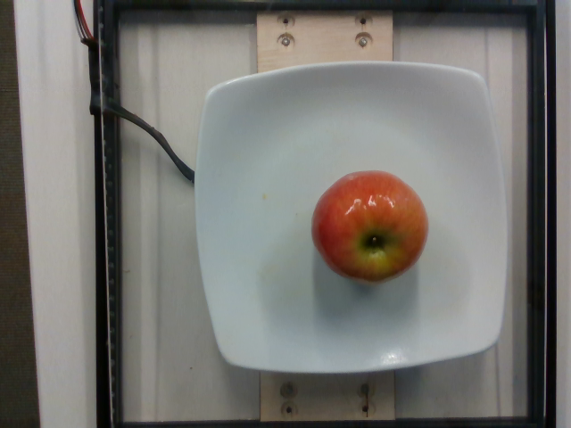

[Źródło](https://storage.googleapis.com/nutrition5k_dataset/nutrition5k_dataset/imagery/realsense_overhead/dish_1558723777/rgb.png) · CC BY 4.0 · proponowana grupa: products. Human reference i provider consent pozostają null.

### n5-02 — dish_1558637393

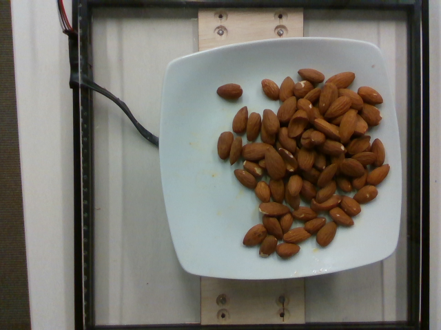

[Źródło](https://storage.googleapis.com/nutrition5k_dataset/nutrition5k_dataset/imagery/realsense_overhead/dish_1558637393/rgb.png) · CC BY 4.0 · proponowana grupa: products. Human reference i provider consent pozostają null.

### n5-03 — dish_1562862493

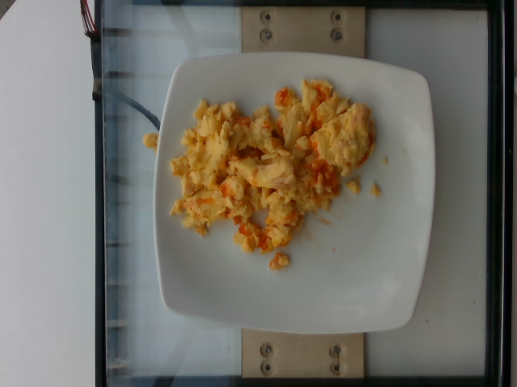

[Źródło](https://storage.googleapis.com/nutrition5k_dataset/nutrition5k_dataset/imagery/realsense_overhead/dish_1562862493/rgb.png) · CC BY 4.0 · proponowana grupa: products. Human reference i provider consent pozostają null.

### n5-04 — dish_1558459276

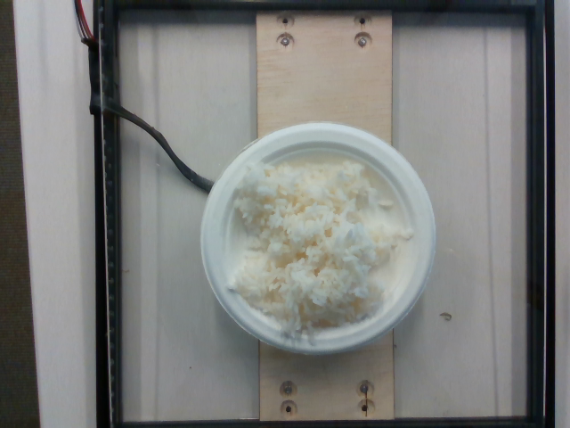

[Źródło](https://storage.googleapis.com/nutrition5k_dataset/nutrition5k_dataset/imagery/realsense_overhead/dish_1558459276/rgb.png) · CC BY 4.0 · proponowana grupa: products. Human reference i provider consent pozostają null.

### n5-05 — dish_1558725253

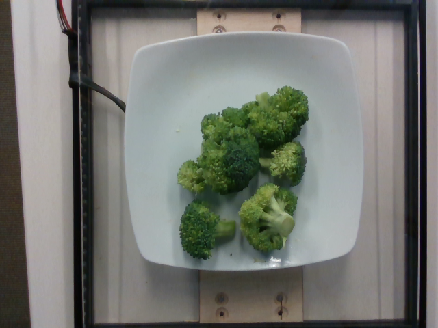

[Źródło](https://storage.googleapis.com/nutrition5k_dataset/nutrition5k_dataset/imagery/realsense_overhead/dish_1558725253/rgb.png) · CC BY 4.0 · proponowana grupa: products. Human reference i provider consent pozostają null.

### n5-06 — dish_1558642089

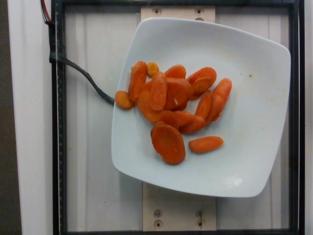

[Źródło](https://storage.googleapis.com/nutrition5k_dataset/nutrition5k_dataset/imagery/realsense_overhead/dish_1558642089/rgb.png) · CC BY 4.0 · proponowana grupa: products. Human reference i provider consent pozostają null.

### n5-07 — dish_1558457530

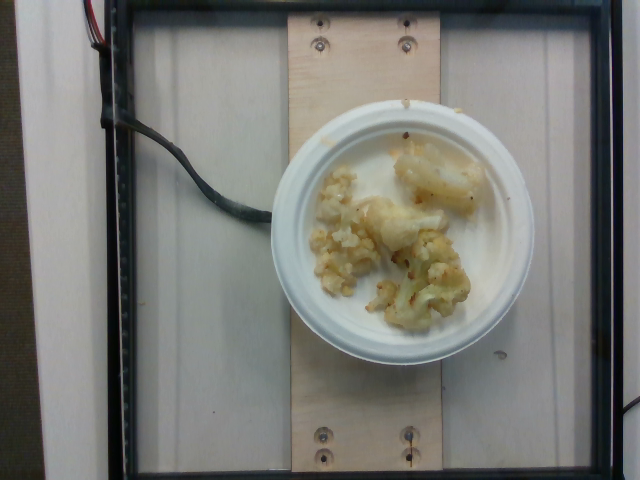

[Źródło](https://storage.googleapis.com/nutrition5k_dataset/nutrition5k_dataset/imagery/realsense_overhead/dish_1558457530/rgb.png) · CC BY 4.0 · proponowana grupa: products. Human reference i provider consent pozostają null.

### n5-08 — dish_1558549008

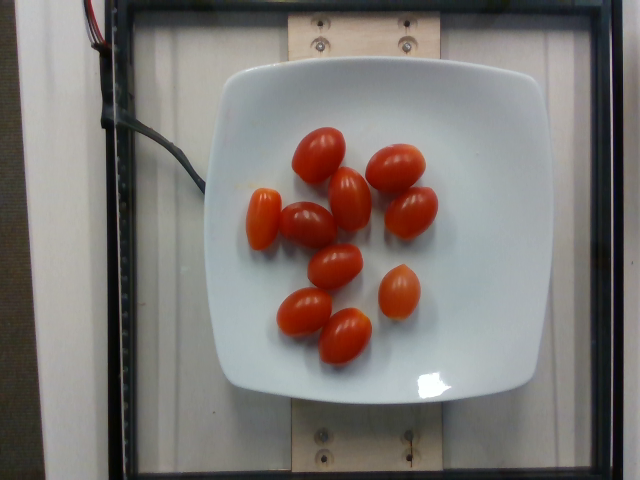

[Źródło](https://storage.googleapis.com/nutrition5k_dataset/nutrition5k_dataset/imagery/realsense_overhead/dish_1558549008/rgb.png) · CC BY 4.0 · proponowana grupa: products. Human reference i provider consent pozostają null.

## Dania mieszane — 8 kandydatów

### n5-09 — dish_1560455030

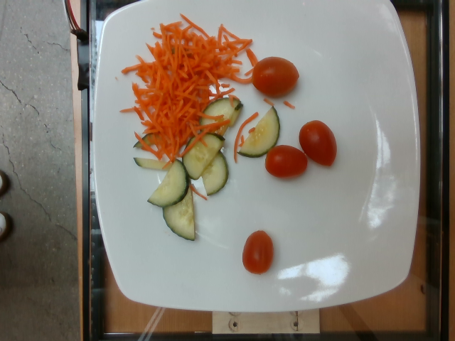

[Źródło](https://storage.googleapis.com/nutrition5k_dataset/nutrition5k_dataset/imagery/realsense_overhead/dish_1560455030/rgb.png) · CC BY 4.0 · proponowana grupa: mixed. Human reference i provider consent pozostają null.

### n5-10 — dish_1563207364

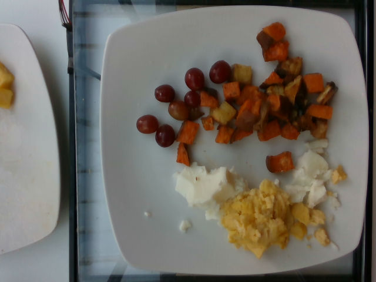

[Źródło](https://storage.googleapis.com/nutrition5k_dataset/nutrition5k_dataset/imagery/realsense_overhead/dish_1563207364/rgb.png) · CC BY 4.0 · proponowana grupa: mixed. Human reference i provider consent pozostają null.

### n5-11 — dish_1561575474

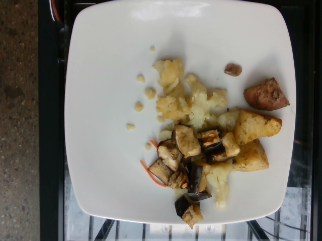

[Źródło](https://storage.googleapis.com/nutrition5k_dataset/nutrition5k_dataset/imagery/realsense_overhead/dish_1561575474/rgb.png) · CC BY 4.0 · proponowana grupa: mixed. Human reference i provider consent pozostają null.

### n5-12 — dish_1561739238

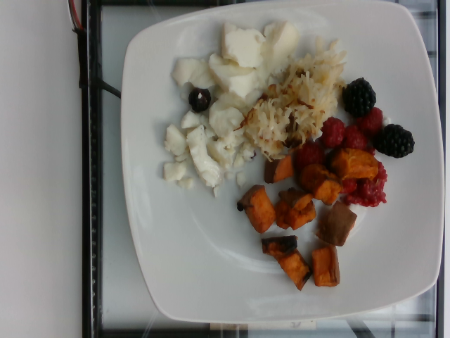

[Źródło](https://storage.googleapis.com/nutrition5k_dataset/nutrition5k_dataset/imagery/realsense_overhead/dish_1561739238/rgb.png) · CC BY 4.0 · proponowana grupa: mixed. Human reference i provider consent pozostają null.

### n5-13 — dish_1562691032

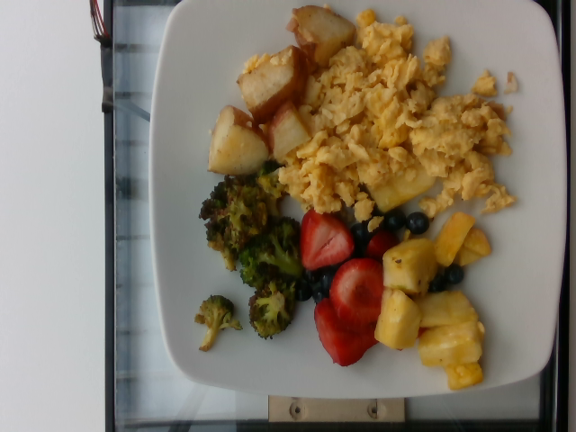

[Źródło](https://storage.googleapis.com/nutrition5k_dataset/nutrition5k_dataset/imagery/realsense_overhead/dish_1562691032/rgb.png) · CC BY 4.0 · proponowana grupa: mixed. Human reference i provider consent pozostają null.

### n5-14 — dish_1563822597

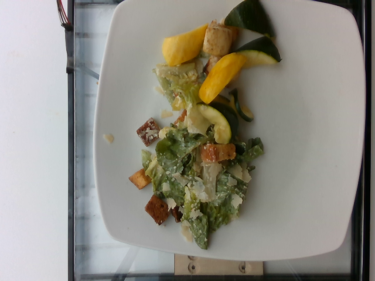

[Źródło](https://storage.googleapis.com/nutrition5k_dataset/nutrition5k_dataset/imagery/realsense_overhead/dish_1563822597/rgb.png) · CC BY 4.0 · proponowana grupa: mixed. Human reference i provider consent pozostają null.

### n5-15 — dish_1563984242

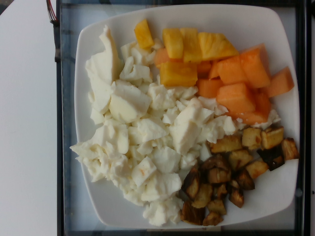

[Źródło](https://storage.googleapis.com/nutrition5k_dataset/nutrition5k_dataset/imagery/realsense_overhead/dish_1563984242/rgb.png) · CC BY 4.0 · proponowana grupa: mixed. Human reference i provider consent pozostają null.

### n5-16 — dish_1565119669

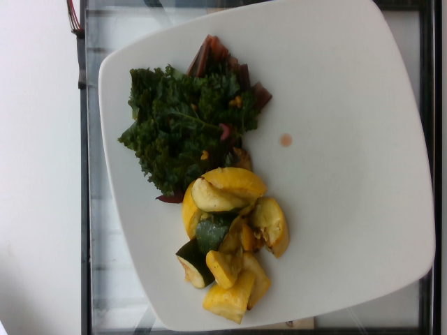

[Źródło](https://storage.googleapis.com/nutrition5k_dataset/nutrition5k_dataset/imagery/realsense_overhead/dish_1565119669/rgb.png) · CC BY 4.0 · proponowana grupa: mixed. Human reference i provider consent pozostają null.

## Racje/składniki — 10 kandydatów

### commons-01 — File:MRE contents.jpg

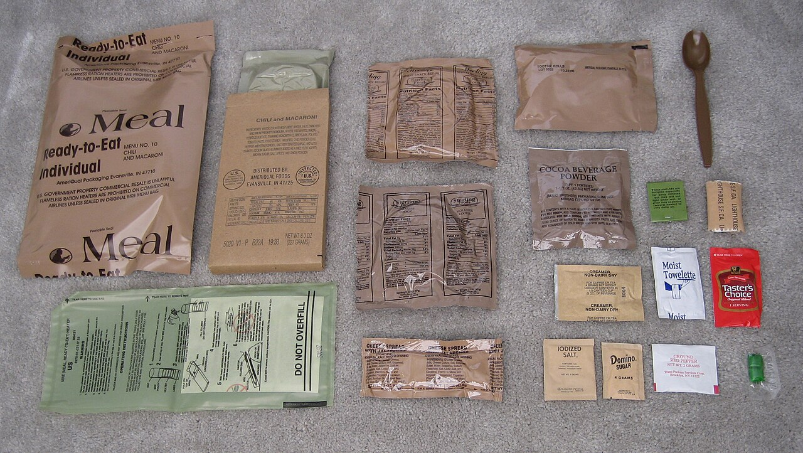

[Źródło](https://commons.wikimedia.org/wiki/File:MRE_contents.jpg) · CC BY-SA 3.0 · proponowana grupa: rations. Human reference i provider consent pozostają null.

### commons-02 — File:MRE Menu 2 P8152664.jpg

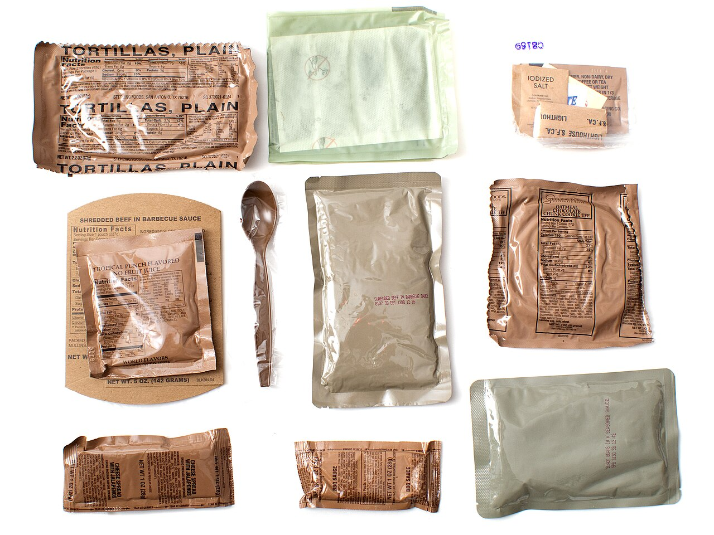

[Źródło](https://commons.wikimedia.org/wiki/File:MRE_Menu_2_P8152664.jpg) · CC BY-SA 4.0 · proponowana grupa: rations. Human reference i provider consent pozostają null.

### commons-03 — File:MRE Chicken Tetrizzini.jpg

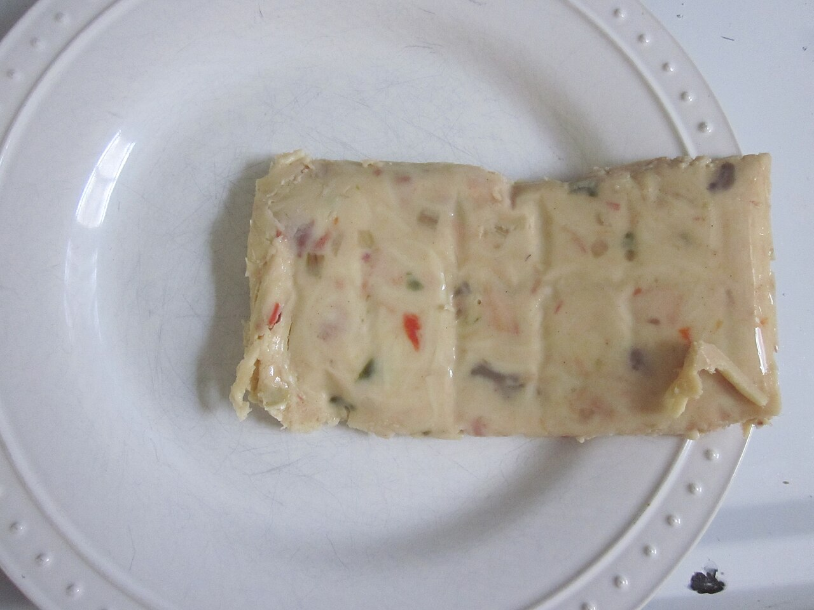

[Źródło](https://commons.wikimedia.org/wiki/File:MRE_Chicken_Tetrizzini.jpg) · CC BY 2.0 · proponowana grupa: rations. Human reference i provider consent pozostają null.

### commons-05 — File:MRE BEVERAGE POWDER 2018.jpg

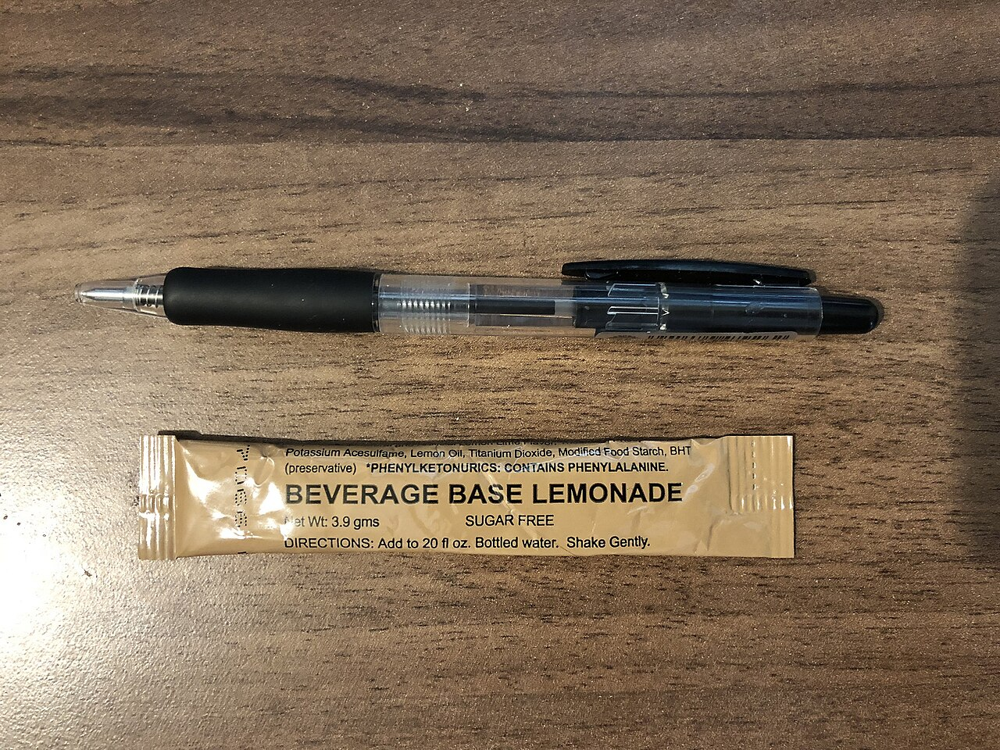

[Źródło](https://commons.wikimedia.org/wiki/File:MRE_BEVERAGE_POWDER_2018.jpg) · CC BY-SA 4.0 · proponowana grupa: rations. Human reference i provider consent pozostają null.

### commons-07 — File:MRE Menu 22 JAMBALAYA20071124.PNG

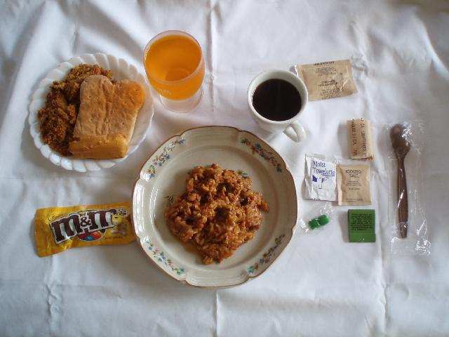

[Źródło](https://commons.wikimedia.org/wiki/File:MRE_Menu_22_JAMBALAYA20071124.PNG) · CC BY-SA 3.0 · proponowana grupa: rations. Human reference i provider consent pozostają null.

### commons-08 — File:FEMA - 39888 - Example of a Meal Ready to Eat, or MRE Kit that contains peanut butter packets..jpg

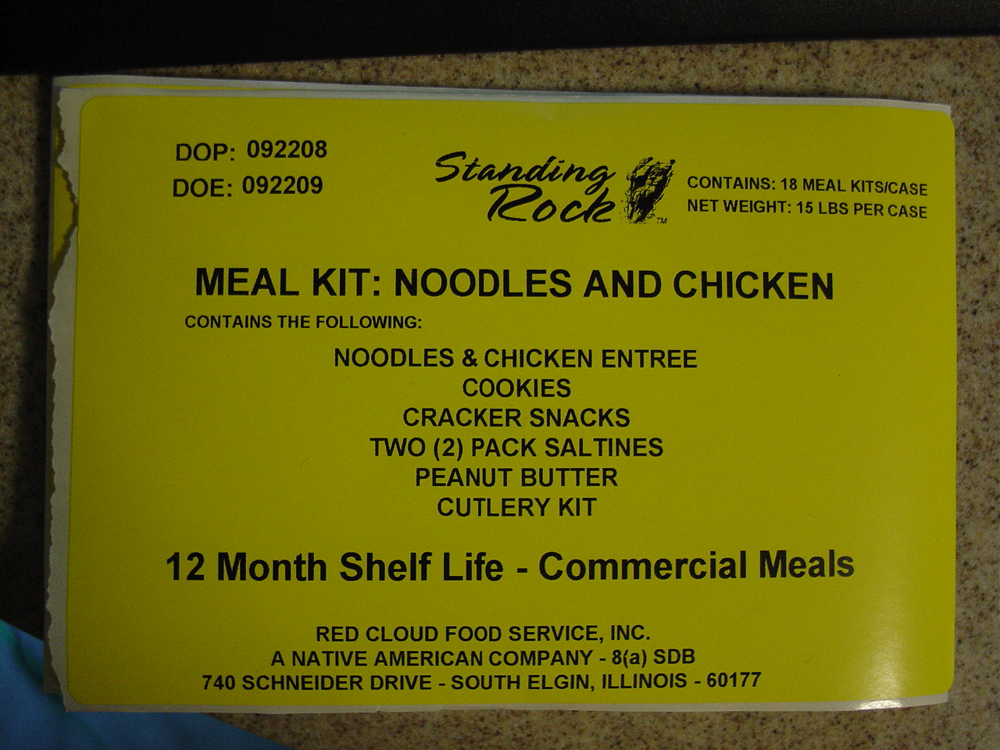

[Źródło](https://commons.wikimedia.org/wiki/File:FEMA_-_39888_-_Example_of_a_Meal_Ready_to_Eat,_or_MRE_Kit_that_contains_peanut_butter_packets..jpg) · Public domain · proponowana grupa: rations. Human reference i provider consent pozostają null.

### commons-09 — File:Eating at MRE'ils - 2021 Edition - New Orleans after Hurricane Ida - pasta with red sauce and tortilla.jpg

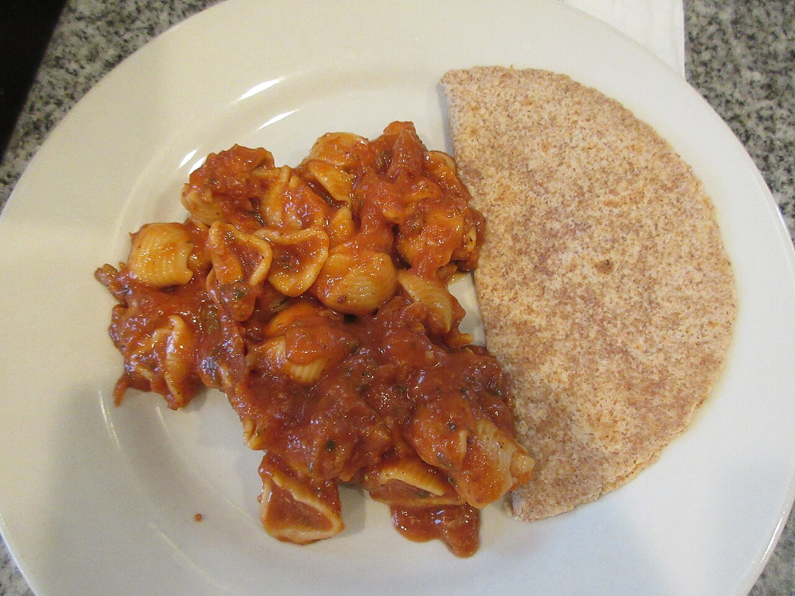

[Źródło](https://commons.wikimedia.org/wiki/File:Eating_at_MRE%27ils_-_2021_Edition_-_New_Orleans_after_Hurricane_Ida_-_pasta_with_red_sauce_and_tortilla.jpg) · CC BY 2.0 · proponowana grupa: rations. Human reference i provider consent pozostają null.

### commons-10 — File:MRE wetpack fruits - commonwealth x920gw36x.jpg

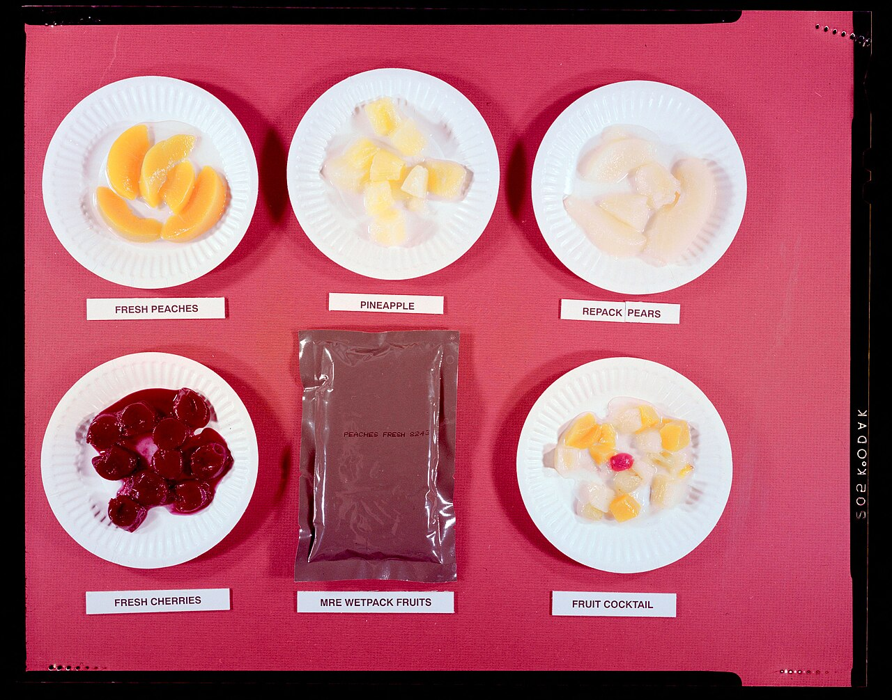

[Źródło](https://commons.wikimedia.org/wiki/File:MRE_wetpack_fruits_-_commonwealth_x920gw36x.jpg) · Public domain · proponowana grupa: rations. Human reference i provider consent pozostają null.

### commons-04 — File:MRE Brick of Rice.jpg

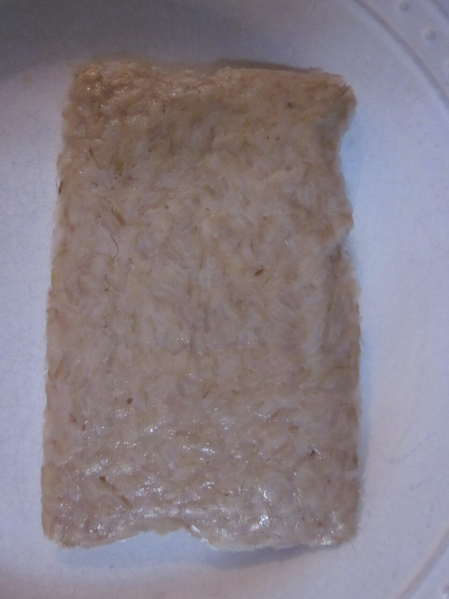

[Źródło](https://commons.wikimedia.org/wiki/File:MRE_Brick_of_Rice.jpg) · CC BY 2.0 · proponowana grupa: rations. Human reference i provider consent pozostają null.

### commons-06 — File:MRE GRANOLA 2017update.jpg

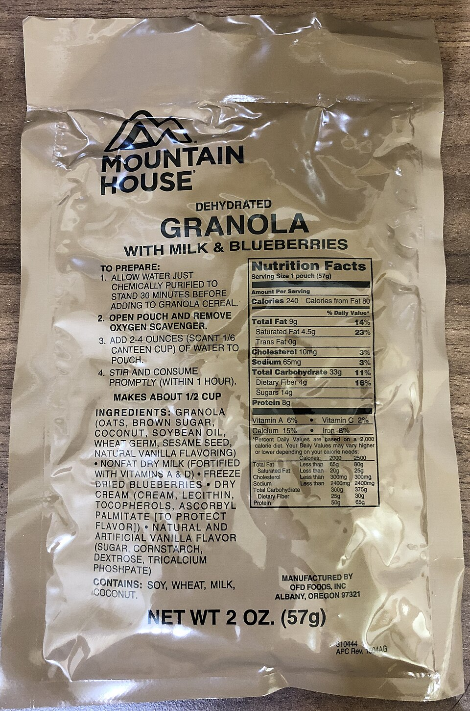

[Źródło](https://commons.wikimedia.org/wiki/File:MRE_GRANOLA_2017update.jpg) · CC BY-SA 4.0 · proponowana grupa: rations. Human reference i provider consent pozostają null.

## Naturalnie zasłonięte jedzenie — 4 kandydatów

### commons-15 — File:Banana leaf wrap.jpg

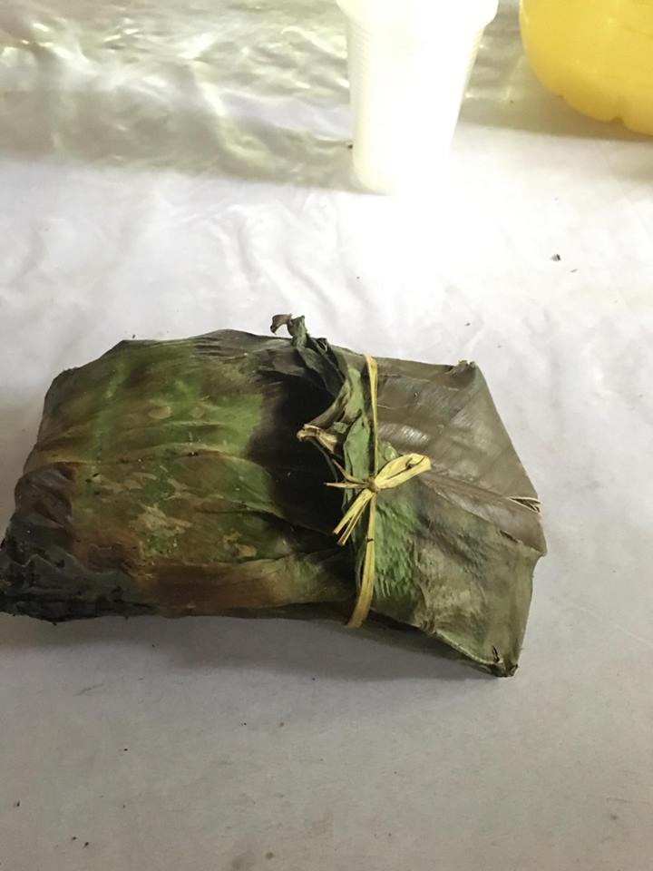

[Źródło](https://commons.wikimedia.org/wiki/File:Banana_leaf_wrap.jpg) · CC BY-SA 4.0 · proponowana grupa: unreadable. Human reference i provider consent pozostają null.

### commons-16 — File:Cooking the Traditional Way.jpg

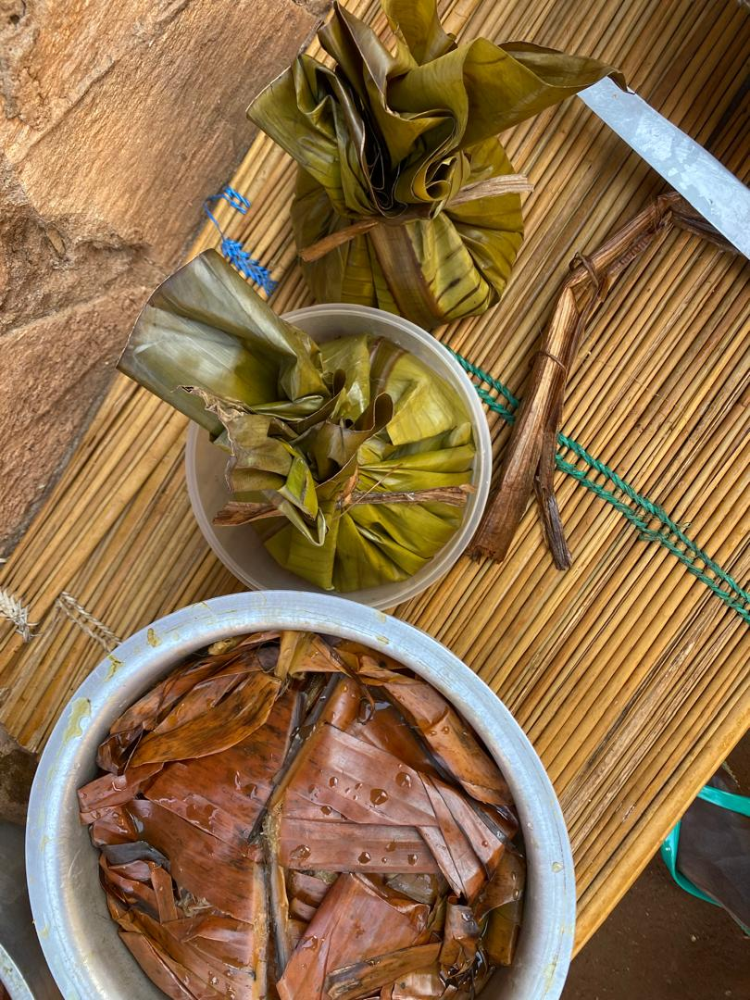

[Źródło](https://commons.wikimedia.org/wiki/File:Cooking_the_Traditional_Way.jpg) · CC BY 4.0 · proponowana grupa: unreadable. Human reference i provider consent pozostają null.

### commons-17 — File:Botok, wrapped in banana leaf.jpg

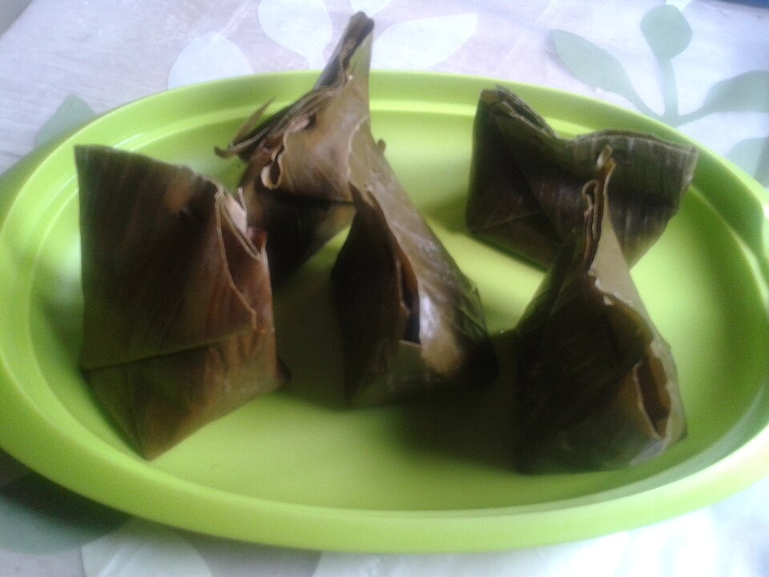

[Źródło](https://commons.wikimedia.org/wiki/File:Botok,_wrapped_in_banana_leaf.jpg) · CC BY-SA 4.0 · proponowana grupa: unreadable. Human reference i provider consent pozostają null.

### commons-18 — File:Kesong Puti (unopened) from Laguna, Feb 2024.jpg

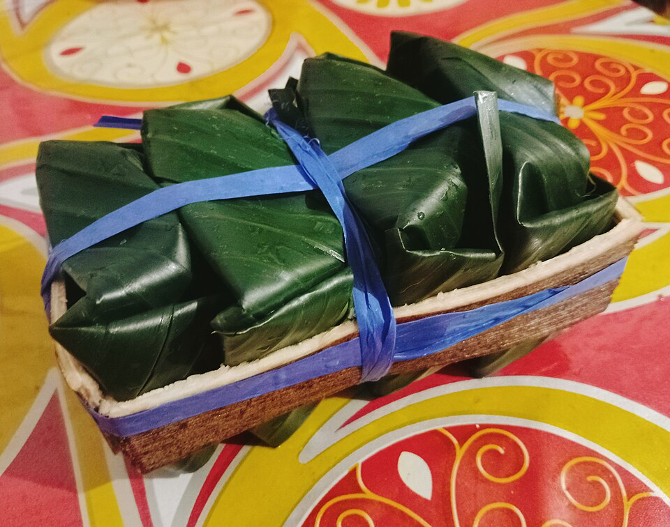

[Źródło](https://commons.wikimedia.org/wiki/File:Kesong_Puti_(unopened)_from_Laguna,_Feb_2024.jpg) · CC BY-SA 4.0 · proponowana grupa: unreadable. Human reference i provider consent pozostają null.
