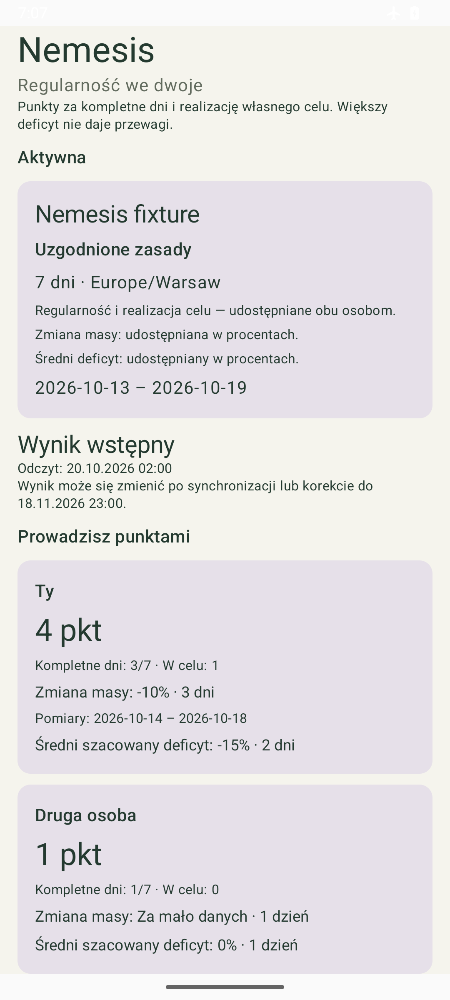
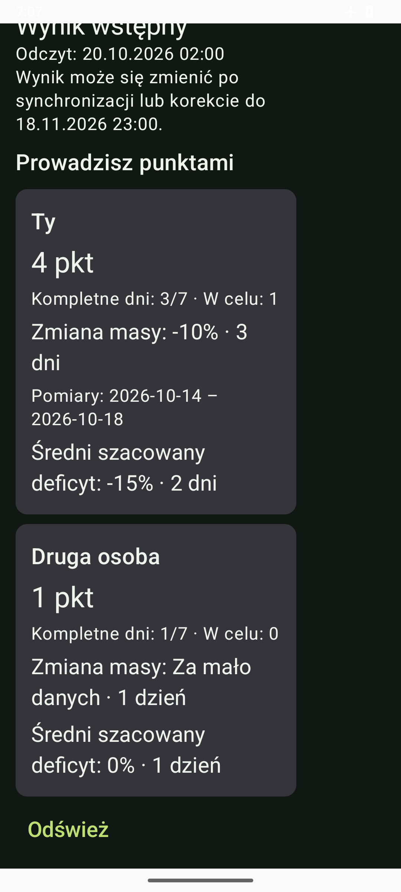

# Android 0.8.10 — odczyt rywalizacji Nemesis

Profil → Nemesis pokazuje bieżącą listę rywalizacji, uzgodnione zasady i porównanie wyników. Dziennik, Postępy i osiągnięcia pozostają dostępne offline. Nemesis wymaga konta, skonfigurowanego API i aktualnego udostępniania obu osób.

Źródło: `ef68cdf5ff5132512ed1e7d8c9dbfdff954ec261`, gałąź `codex/android-nemesis`, versionCode21/Room8 bez migracji. APK pozaGit: `Racje-i-kalorie-0.8.10-debug.apk`, SHA-256 `c6c5aeb43e26bb3c37201b3401850ff4710f66100ed8bfd0869aff532c6414c0`. Własny parent [PR55](https://github.com/Roseru/aplikacja-mobilna/pull/55) scalono na0b3af43f9d455ca04ffbb8a400eb81de35d2f042 po świeżym guardzie c5de7ab/base28f70a5,8 success [CI38445131219](https://github.com/Roseru/aplikacja-mobilna/actions/runs/38445131219). Zwykły merge366e2b6 dołączył parent bez zmian Androida; ten etap kierujemy do main.

## Dostarczony zakres

- Lista25 własnych rywalizacji i następne live pages; cursor tylko wRAM, retry tego samego odczytu,409 wymaga świeżej listy. Nie deduplikujemy równych pseudonimów ani stron zmieniających się na żywo.
- Każdy odczyt ma prywatny preflight motywacji i kontrolę lease/account/generation/epoch/context/operation/token przed wysłaniem i przed zastosowaniem. Szczegóły pobierają świeże metadata, a tylko active/finished pobierają statistics; bez używania starej zgody lub rank opt-in jako uprawnienia Nemesis.
- Oddzielne rewizje: lifecycle1..Int.MAX_VALUE, statistics1..Long.MAX_VALUE. W tej samej widocznej rywalizacji starsza revision/as_of jest odrzucana. Wersja odczytu pozostaje wRAM i nie jest sync checkpointem.
- Pending czeka na dojrzały dzień i nie prezentuje wyniku/remisu. Provisional i final pokazują punkty oraz wynik wyłącznie regularity_v1. Scope hidden nie ujawnia counts/dates, insufficient_data ma null z jawnym brakiem, available zachowuje dokładny BigDecimal, w tym zero i wartości ujemne. Duże liczby mają czytelny zapis z jawnym przybliżeniem; model nie używa Float/Double.
- Period7/30/90, zaakceptowana strefa IANA, wyłączny end_date i deadline=end_at+720hUTC. Finalized_at musi być po deadline i nie później niż as_of; final ma wszystkie dojrzałe daty. Liczności, punkty, outcome i daty pomiarów są walidowane wspólnie.
- GET po otwarciu/powrocie, polling wybranych szczegółów co45s tylko przy RESUMED. Stop/leave/logout/account/generation/epoch/context usuwają podgląd, cursor, wersję i uprawnienie spóźnionej odpowiedzi. Cancelled metadata usuwa dawny pseudonim, także przy wirtualnym expiry.404 nie przywraca starego wyniku.
- HTTPS bez redirects/cache/compression; X-Sync-Epoch wyłącznie bieżący UUID, bez mutation headers wGET. Bounded1MiB success/64KiB error, strictUTF8/JSON/unknown fields. Protected JSON errors także wymagają no-store;429/503 proxy body jest ignorowane, ale Retry-After respektowane. Jeden wspólny trwały backoff i najwyżej jeden refresh401 w całej sekwencji.

## Weryfikacja i granice dowodów

Pierwsza pełna wersja `b355fe4dc481f4ffa839945d0b5c8cd4123bc43d`:155 JVM/168 device PASS, failures/errors/skipped0, lint0error/4 istniejące warning/1info; pipeline14m20s, urządzenie570.372s. Po dodaniu kontroli rewizji/as_of:155 JVM/72 affected device PASS(68SessionSecurity+4NemesisUI), errors/skips0; urządzenie123.558s. Zakresów nie sumujemy; nie deklarujemy lokalnego pełnego169 dla końcowego źródła. Final-head zdalny CI wykona własny zestaw.

Testy obejmują cztery opublikowane DTO, signed/null/hidden/zero, rozbieżne counts/outcome/windows/finalization,7/30/90DST,64-bit revision, granice/UTF8/duplicate keys, no-store błędów, ścieżki/epokę i fence przedHTTP. RealRoom/Keystore z fixtures: bootstrap/preflight, niezmieniony lokalny profil/cel/posiłki/outbox/binding, restart bez prywatnego cache, lost response, cursor409, wspólny durableRetryAfter,401once, zamknięcie widoku/A→B→A/gen/epoch i spóźnione statistics. Oddzielne fixture tests nie zaliczają realnego API/OIDC/TLS.

Install-r/launch/baseline zachował wszystkie kolumny22tabel,5posiłków, kolejkę/archiwum i FK. Bez clear/uninstall. Prywatne XML/baseline/dziennik/zrzut pozaGit; publiczne PNG są wyłącznie syntetycznevalidation.

## Pozostałe wymagane kroki

Ten etap dostarcza odczyt. Wydanie/revoke kodu, utworzenie zaproszenia, accept/cancel, wybór okresu/strefy i opcjonalnych scope z obustronną zgodą pozostają następnym etapem klienta. Mutacje wymagają dokładnej trwałej intencji przed siecią, własnego UUID key i aktualnego epoch, a accept/cancel także quoted lifecycleIfMatch. Utrata ACK/restart ma ponowić ten sam body/key/target/revision, bez automatycznego replay lub regrant po restore. Nie zastępujemy pełnego Nemesis samym odczytem.

Rzeczywisty APK/API czeka na osiągalny origin/issuer/publicCA/callback od O3; jego lokalny rollout0024/operator HTTPS nie zalicza telefonu. Domyślnie capability jest closed; brak danych lub503 nie jest zerowym wynikiem. Pełne E4/WorkManager/KO31/recovery, klientE9/state/requested/effective/notice/affirm i wydanie pozostają otwarte.
