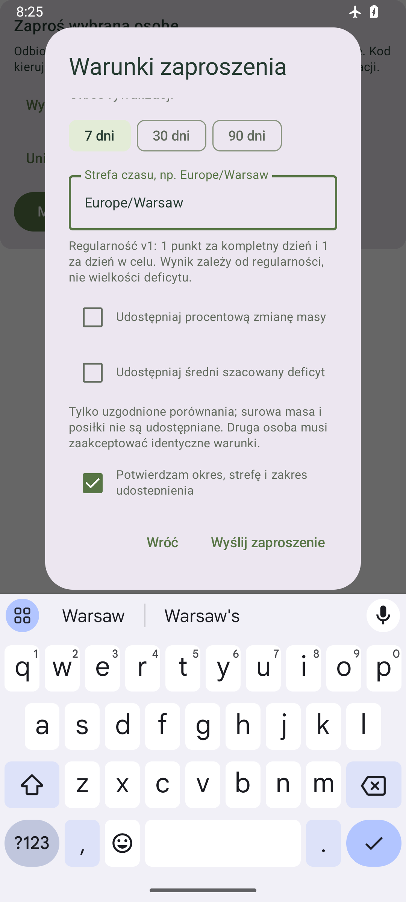
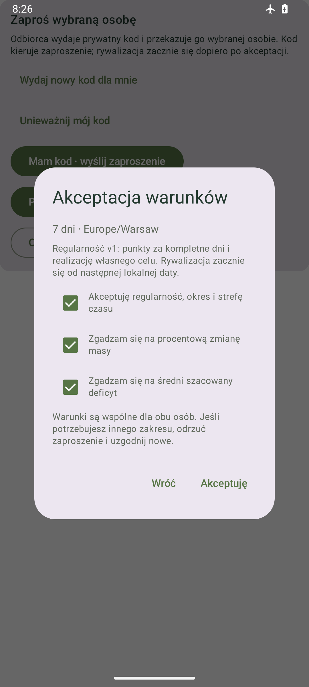

# Android 0.8.11 — zaproszenia i decyzje Nemesis

Profil → Nemesis pozwala wydać lub unieważnić prywatny kod, zaprosić wybraną osobę, zaakceptować warunki oraz zakończyć udostępnianie. Utrata odpowiedzi pozwala ręcznie ponowić tę samą zatwierdzoną decyzję. Gęstszy ranking 0.8.9, kompaktowe osiągnięcia 0.8.6 i zaakceptowane Postępy pozostają zachowane.

Źródło Androida: `7a0f89e4bce9c147a927cd365fc999b3e54ebcb0`, gałąź `codex/android-nemesis-operacje`, versionCode22/Room8 bez migracji. Zwykły merge `2212f6e92d88f5b24352674502b2e54a695707bf` dołącza main `6599e8bc69a53c6792340ab7d8ac17048fcbc043` bez dalszych zmian kodu. APK poza Git: `Racje-i-kalorie-0.8.11-debug.apk`, SHA-256 `c0de7755c1ddf6eebaaa82843de67184209130c5ebe68c551280fe107b826e7a`.

## Zachowanie

- Kod odbiorcy jest prywatny, ważny najwyżej 24 godziny. Kopiowanie do schowka wymaga kliknięcia i oznacza zawartość jako wrażliwą. Kod oraz wklejony formularz pozostają w RAM; zamknięcie ekranu lub przejście aplikacji w tło usuwa podgląd. Samo wydanie kodu nie rozpoczyna rywalizacji.
- Zaproszenie określa okres 7/30/90 dni, strefę IANA i regularity_v1. Procentowa zmiana masy i średni szacowany deficyt są opcjonalne i domyślnie wyłączone. Wysłanie wymaga potwierdzenia aktualnych warunków; ich zmiana kasuje checkbox potwierdzenia.
- Akceptacja wymaga świeżego odczytu zaproszenia, potwierdzenia regularności oraz osobnych zgód na każdy zaproponowany zakres. Odświeżony odczyt unieważnia wcześniejsze uprawnienie formularza. Inny zakres wymaga nowego zaproszenia. Punkty zależą od regularności, a nie wielkości deficytu.
- Wycofanie/odrzucenie zaproszenia i zakończenie udostępniania wymagają jawnego potwierdzenia. Unieważnienie kodu lub wycofanie udziału nie zależy od dostępności materializacji motywacji; backend nadal sprawdza tożsamość i uprawnienia.
- Formularze przewijają treść przy otwartej klawiaturze. Przycisk zatwierdzenia pozostaje dostępny, a Done zamyka klawiaturę. Zrzut tworzenia pokazuje formularz po przewinięciu do końcowego potwierdzenia.

## Trwałość i zgodność API

Dokładna intencja trafia do jednego istniejącego szyfrowanego magazynu sesji przed jakimkolwiek mutującym HTTP. Zapis jest odczytywany i porównywany przed wysłaniem. Ponowienie zachowuje body, UUID Idempotency-Key, endpoint, właściciela, epokę i lifecycle If-Match; nie tworzy nowego klucza przy niepewnej odpowiedzi. Restart ani ponowne logowanie nie wysyłają decyzji automatycznie. Nie powstaje drugi writer Vault, encja partnera w Room ani operacja w kolejce dziennika.

POST/DELETE używają bieżącego X-Sync-Epoch; accept/cancel dodatkowo mają cytowaną wersję lifecycle. Wydanie, utworzenie i akceptacja sprawdzają przed zapisem świeżą generację/epokę motywacji. Kontrole lease/account/generation/epoch/context/ticket/operation działają przed fizycznym HTTP i zastosowaniem odpowiedzi. Zmiana kontekstu odrzuca dawną intencję; uszkodzony journal blokuje nową decyzję. 401 ma najwyżej jedno odnowienie w sekwencji, a 429/503 korzystają ze wspólnego trwałego Retry-After. HTTPS nie używa redirects/cache; odpowiedzi są ograniczone i walidowane, w tym no-store dla chronionego JSON.

Replay backendu może zwrócić bieżące metadata, również już anulowane. Potwierdzenie operacji nie jest uprawnieniem do udostępniania i nie jest stosowane jako aktualny wynik Nemesis. Nowy podgląd wymaga świeżego GET. Terminalny konflikt lub wygaśnięcie wymaga ponownego odczytu i nowej świadomej decyzji.

## Weryfikacja

- Pierwsze pełne źródło `9d2f7dbd82e76abd1252e054d33b402d7b243636`: build, 165 JVM, 179 testów urządzenia API35 PASS; failures/errors/skipped=0; pipeline15m37s, urządzenie616.975s.
- Po zmianie obsługi klawiatury: końcowy build, 165 JVM, lint0error/4 istniejące warning/1info oraz 4 testy formularzy PASS; urządzenie55.09s. Test tworzenia wykonuje rzeczywiste kliknięcie widocznego przycisku. To zmieniony zakres, nie drugi pełny179 ani suma183. Zdalny CI sprawdzi pełny zestaw końcowego źródła.
- Pierwsza korekta klawiatury `a69c7760cfcdcd54c8caaed9b641e9c40ec36aed` przeszła testy, ale końcowy guard wykrył dwa nowe warning lint. Nie zaliczono jej jako finalnego artefaktu. Poprawiono obliczenie na LocalWindowInfo rodzica i fabrykę Modifier; świeże wyniki końcowe oraz PNG zweryfikowano po poprawce.
- Testy protokołu/HTTP: dokładne bytes/headers/If-Match, brak body dla kodu, canonical code, role, TTL, replay bieżącego anulowania, rozmiary/UTF8, fence przed wysłaniem, no-store i wspólny backoff.
- RealRoom/Keystore z transportem fixture: trwałość przed HTTP, utrata ACK/restart i ten sam klucz, brak auto replay, niepełne zgody, nieaktualny formularz, revoke/cancel przy niedostępnej motywacji, spóźniona odpowiedź, wyjście/logout/A→B→A/epoch, preflight drift i503/409. Fixtures nie potwierdzają rzeczywistego API/OIDC/TLS.
- Install-r oraz porównanie przed instalacją, po instalacji i po pierwszym uruchomieniu: wszystkie kolumny22tabel/5posiłków zachowane; Room8 i foreign_key_check bez błędów. Bez clear/uninstall. Prywatny dziennik, baseline i zrzut produkcyjny pozostają poza Git.

PNG pochodzą z osobnej aplikacji validation i syntetycznych danych. Nie są zrzutem prawdziwego partnera, konta lub dziennika.

## Integracja i dalsze kroki

Własny odczyt [PR60](https://github.com/Roseru/aplikacja-mobilna/pull/60) scalono na `6599e8bc69a53c6792340ab7d8ac17048fcbc043`: final-head `9f8b48434bf52a4519aaf2e2b93ade888631cd9c` zastępuje wcześniejsze przebiegi. Dokładny final-head jest rozliczony we wpisie O1-027; osiem kontroli [CI38459553051](https://github.com/Roseru/aplikacja-mobilna/actions/runs/38459553051) miało success, przy bazie/mainb174bbe i świeżym odczycie uwag. To CI odczytu0.8.10, nie potwierdzenie nowego0.8.11. Nowy etap ma własny PR i CI.

Przeczytano przekazanie O2/O3 i dołączono PR59 zwykłym merge rodzica. Proponowany corpus zdjęć nadal jest offline, bez zatwierdzenia człowieka/zgód/uploadów; nie wykonano Gemini ani zmian usług. Rzeczywisty APK/API oraz pairing obu kont wymagają osiągalnego z urządzenia origin/issuer/publicCA/callback od O3. Lokalny rollout operatora nie zalicza telefonu. SemantyczneE4/push/ACK/import/WorkManager/KO31/recovery i pełny klientE9 pozostają otwarte. Następny wydzielony etap O1 to stan i świadome decyzje korekty zapotrzebowania; oś zapotrzebowania jest oddzielna od celu kalorii.

O1-027 — odczyt nowego O3-024: PR57/head `f6a2999ec8194e3cc00ea00366d98369bf480b47`, diff do aktualnego main oraz nowy wpis w dzienniku zostały przeczytane. O3 potwierdza własny rollout0024 i scratch restore nową epoką, z zachowaniem epoki źródła. Brak przypisanego dawnego LAN nadal ogranicza odbiór telefonu; runtime/kontrakty pozostają odebranym E9. Wcześniejsze osiem kontroli3eca dotyczy poprzedniej bazy, nowy PR57 wymaga własnego CI. O1 nie przejmował scalania PR57/usług, nie wykonał za O3 restore i nie uznał go za odbiór APK. Priorytet wspólnego rzeczywistego API oraz pytanie o osiągalny origin pozostają aktualne.

Publikacja O1-027: [PR61](https://github.com/Roseru/aplikacja-mobilna/pull/61), `codex/android-nemesis-operacje` do main `6599e8bc69a53c6792340ab7d8ac17048fcbc043`; pierwszy opublikowany head `1d8a18c6b1b23553fe3e0f0721239431263339d0`. PR bez draft i podpięty do rozmowy. Po dokumentacji E0 PASS:10schemas/95valid/35invalid/18scenarios/16Decimal/5complete/72normalizations/605links oraz diff-check. Pierwszy CI38464256385 jest w toku; contracts success, pozostałe kontrole oczekują. Odczyt uwag:reviews/inline/issue0. Nie deklarujemy jeszcze8success/merge lub realAPI. Ten dopisek ma własny końcowy head/CI; źródło Androida i APK pozostają identyczne.0.8.11/code22 jest otwarta w emulatorze, potwierdzone zachowanie danych także po pierwszym uruchomieniu.

Integracja O1-027 po nowym main: CI38464478502/head4e8565e593de48ec966bb54c6d7d28404e386178 zaliczył osiem kontroli, reviews/inline/issue0. Main zmienił się na de97b80e899f6fb3d6cfc66f49b0f914db3d9cbc/PR57, więc guard odmówił merge starej bazy. Aktualny main dołączamy zwykłym merge z zachowaniem wszystkich historycznych akapitów obu rodziców i aktualnych wierszy. O3-022/023/024 oraz zapisany błąd pobrania obrazu CI odczytane; nie oznaczamy wcześniejszego RED jako testu urządzenia. Nowy head PR61 otrzyma własne osiem kontroli; źródła Androida/APK0.8.11 nie zmieniają się.0.8.12 powstaje na oddzielnej gałęzi zdjęć i nie należy do tego PR.
