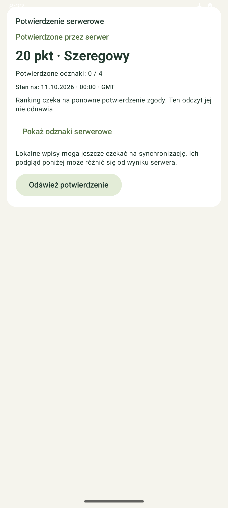
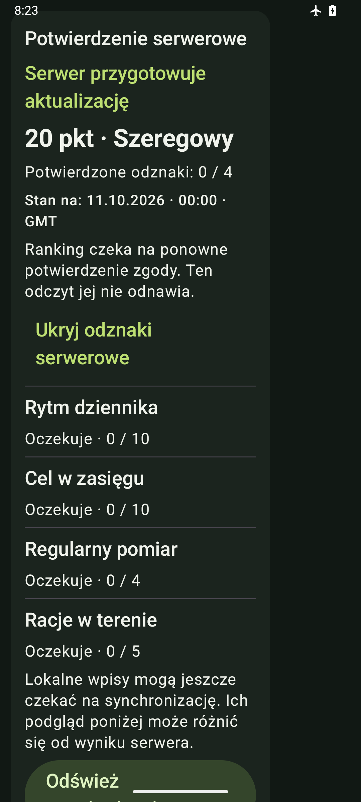
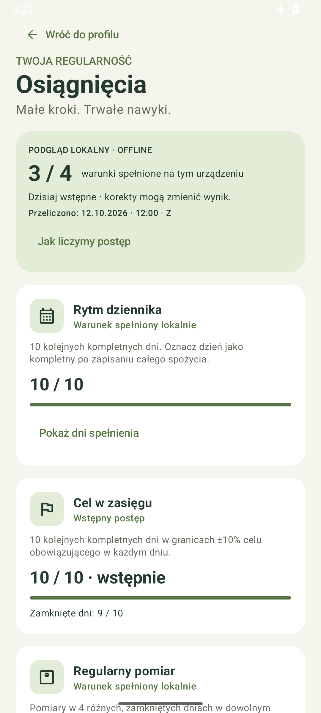
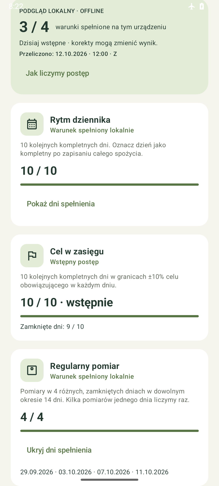
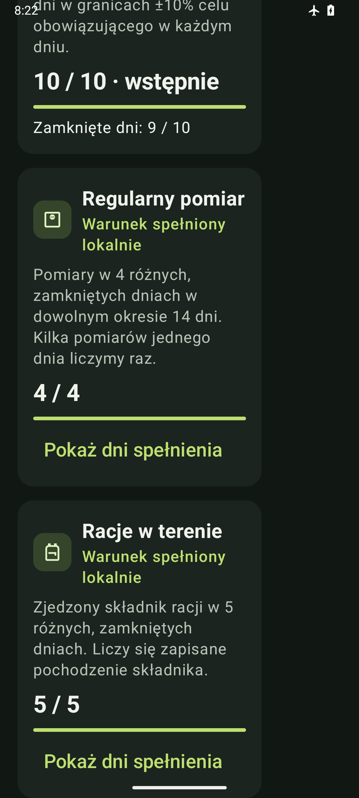

# Android 0.8.6 — prywatne potwierdzenie osiągnięć

12 października 2026. Agent 1 / O1. Gałąź `codex/android-osiagniecia-serwer`. Źródło końcowe `05847a06f6a62fa144dfcd8e78d8a4881c857978`; poprzedni układ83a7178 i poprawka selektora testu c888593; odczyt i sesja404c106261054eea196970bc0a75f9f816b3d55e, baza main a6a77fc45fb72a0de2a41a71de4f7f1e33900309 po [PR40](https://github.com/Roseru/aplikacja-mobilna/pull/40). Wygląd Postępów pozostaje zachowany. Zgodnie z nowym feedbackiem właściciela podsumowanie osiągnięć jest mniejsze: licznik w jednym wierszu, krótkie ostrzeżenie o dzisiaj/korektach i szczegóły obliczeń rozwijane na żądanie, aby wcześniej pokazać odznaki. Panel serwera znajduje się pod lokalnymi odznakami, również w pełnej aplikacji; przewinięcie odsłania konto i pobranie.

## Wynik

„Profil → Osiągnięcia” ma osobny prywatny odczyt GET `/api/v1/me/motivation`. Użytkownik uruchamia pobranie przyciskiem; nie ma automatycznego żądania przy otwarciu strony. Po zalogowaniu i bootstrapie panel pokazuje własne punkty, rangę, datę aktualności i cztery odznaki serwera, niezależnie od lokalnego podglądu całej historii. Rozwijane szczegóły odróżniają oczekiwanie, przyznanie i cofnięcie po korekcie oraz pokazują daty potwierdzające przyznaną odznakę.

`pending_backfill` pozostawia punkty/rangę niedostępne, bez fikcyjnego zera. `pending_materialization` pokazuje dotychczasowy potwierdzony wynik z informacją o przygotowywaniu aktualizacji. `final` pokazuje potwierdzenie na `as_of`; stan całej projekcji nie oznacza automatycznego przyznania wszystkich odznak. Lokalny wynik nadal działa offline i może różnić się od serwera, ponieważ outbox jeszcze nie został wysłany przez pełny adapter E4.

Panel pokazuje requested/effective/pending_consent_refresh i ewentualną własną pozycję. Odczyt **nie odnawia ani nie zmienia zgody rankingu**. Nie ma PUT zgód, publicznej listy rankingu ani operacji Nemesis. Wyłączony udział, oczekiwanie na ponowną zgodę, zapisana zgoda z niedostępną publikacją i niedostępna pozycja są odrębnymi stanami. Zapisana i świeża zgoda może jeszcze czekać na gotowy profil/backfill; nie pokazujemy jej jako wyłączonej. Punkty wynikają z regularności serwerowej; lokalna odznaka nie nalicza punktów.

Gość i instalacja bez publicznego API mają dostęp do lokalnych osiągnięć oraz przejścia do konta. Powrót z konta prowadzi do osiągnięć. Domyślny APK nie ma skonfigurowanego API/issuer i nie wykonuje rzeczywistego odczytu z wdrożenia.

## Odczyt i izolacja

- Wspólny transport profilu/motywacji używa HTTPS systemowego, bodyless GET, Bearer, `Cache-Control: no-store`, bez przekierowań, query właściciela i nagłówków mutacji. Sukces wymaga `no-store` odpowiedzi, JSON i limitu 64 KiB, również bez Content-Length. Opóźnienie proxy429/503 obowiązuje bez czytania prywatnego HTML.
- DTO ma ścisłe pola, typy/liczby całkowite bez zaokrągleń, cztery unikalne kody, regułę `regularity_v1`, spójne progi rang, świadectwa dat i statusy. Historyczne daty przyznania mogą pozostać podczas backfill. Wyświetlamy `as_of`, a revision/source_position pozostają osobnymi polami; nie stają się checkpointem synchronizacji.
- Odpowiedź jest tylko w pamięci aktywnej sesji; restart nie odtwarza jej z dysku. Logout, rozpoczęcie logowania, refresh, bootstrap oraz zmiana lease/generation/epoch/contextRevision usuwają podgląd. Room obserwuje także zewnętrzną zmianę kontekstu. Przejście konta ukrywa dane w UI od razu.
- Kontrola odbywa się przed wysłaniem i po odpowiedzi. Spóźnione dane po logout/A→B→A, odnowieniu sesji i zmianie rewizji są odrzucane. Inna generacja/epoka oznacza recovery; nie zastępuje mapowania bootstrapu. Profil, snapshot i motywacja nie wysyłają równoległych odczytów tego samego kontrolera.
- Jedno odnowienie po401; nie wysyłamy starego tokenu po nieudanym refresh. Retry-After jest trwały i wspólny z bootstrapem/profilem; restart nie skraca oczekiwania. Błędy używają stałych komunikatów, bez treści odpowiedzi lub tokenów.

Room pozostaje **8**, bez migracji, zmiany danych dziennika, outbox albo dotychczasowych schematów. Wersja APK **0.8.6 / code17**.

## Weryfikacja

- Pełny odczyt/sesja404c106: **126 JVM / 129 urządzenia PASS**, build i lint0error/4dotychczasowe warning/1info; zero failures/errors/skips. Pełny przebieg11m1s. Obejmuje wcześniejszy Android,12nowych testów urządzenia (8session/4UI) oraz11nowych JVM (9DTO/2transport), bez sumowania ponowień.
- Po późniejszym feedbacku właściciela i doprecyzowaniu requested=true/effective=false finalny83a7178 zmienia tylko UI oraz jego testy. Build,126JVM i lint PASS. Po poprawce selektora IME pełne18 wybranych UI/nawigacji PASS na c888593 (4m40s). Po końcowym przeniesieniu panelu pod odznaki ponownie zaliczono build,126JVM, lint oraz wszystkie18 przypadków trzech zmienionych klas. Zakresy nie są sumowane ani przedstawiane jako lokalny pełny130. Zdalny CI sprawdzi pełny zestaw na swoim head.
- Nowy transport i session mają deterministyczne fixtures z prawdziwymi Room/Keystore. Zakres obejmuje wszystkie cztery DTO, limity/typy/datowanie, no-store/bodyless GET/headers, guest/bootstrap, brak mutacji danych/outbox, brak utrwalonego cache, równoległe tapnięcia, logout/A→B→A, refresh401/manual/expiry, błędny DTO/403/cancellation, wspólny trwały Retry-After oraz zmianę gen/epoch/revision i obserwację Room. UI obejmuje brak punktów podczas backfill, cofnięcie, zgodę wymagającą odnowienia i świeżą zgodę bez gotowości publikacji,320dp/font150% oraz rzeczywistą nawigację gościa.

Wczesny test kompilacji wykrył Int zamiast Long dla contextRevision; poprawiono typ przed dalszym sprawdzaniem. Pierwsze wywołanie zestawu z selektorem urządzenia nie uruchomiło testów, ponieważ PowerShell rozdzielił niezacytowany argument Gradle `-P`; kolejne wywołanie ma poprawnie zacytowany selektor. Pierwszy zestaw urządzenia miał44 PASS/1 FAIL, bez errors/skips: ręczny refresh pozostawiał wskaźnik ładowania starego odczytu. Zachowano XML; poprawka unieważnia identyfikator ręcznie odnowionego odczytu, a test sprawdza także nowy wynik przed nadejściem starej odpowiedzi. Automatyczne odnowienie wewnątrz GET zachowuje własny identyfikator. Pierwszy zakres końcowego UI miał17 PASS/1 FAIL (XML zachowany): starszy test racji po IME Done nie znalazł pola w scalonym drzewie, chociaż raport zawierał dokładnie jeden trafny węzeł w niescalonym drzewie. W pełnym129 ten sam test wcześniej przeszedł. Poprawka selektora sprawdza bezpośrednio oznaczone pole; asercja focus=false, odrębny limit5s/warunek zamknięcia IME oraz dokładna gramatura i baza po edycji/recreate pozostają bez zmian. Nie są to zaliczone próby. Testów zastępczych nie opisujemy jako rzeczywistego logowania/HTTPS/backendu.

Rzeczywisty install-r APK0.8.6/code17 oraz pierwszy launch zachowały wszystkie kolumny22tabel Room8,5posiłków, kolejkę i archiwum. Porównano prywatny baseline przed instalacją, po instalacji i po uruchomieniu; foreign_key_check pusty. Po końcowej zmianie kolejności panelu ponowna aktualizacja i launch także zachowały ten sam baseline. Bez clear/uninstall, dziennik oraz prywatne XML/PNG pozostają poza Git. App otwarta na Osiągnięciach.

APK SHA-256 `95e63068666381d2984952ad52686f0007982ee2250e6028f061e85cd150e522`, lokalnie poza Git. Publiczne podglądy niżej mają wyłącznie syntetyczne dane osobnego pakietu validation. Są podglądem panelu, nie całej aplikacji; wersja320dp pozostawia niewykorzystaną resztę obszaru emulatora. Prywatny zrzut właściciela nie jest publikowany.

## Próba manualna

1. Otwórz Profil → Osiągnięcia jako gość: lokalne karty pozostają dostępne; panel nie pokazuje wymyślonych punktów.
2. „Konto i połączenie” otwiera konto, a „Wróć do osiągnięć” przywraca tę stronę. Popraw wpis dnia albo pomiar i sprawdź przeliczenie lokalnego warunku.
3. W zgodnie skonfigurowanym APK/API po logowaniu i bootstrapie wybierz „Pobierz z serwera”. Porównaj wynik i datę z faktyczną odpowiedzią własnego konta; nie utożsamiaj go z niewysłaną lokalną kolejką.
4. Sprawdź pending_backfill, pending_materialization i revoked na kontrolowanych danych integracyjnych, bez dopisywania prawdziwemu użytkownikowi punktów. Odczyt nie może odnawiać zgody rankingu.
5. Po odczycie wyloguj się lub zmień konto: poprzedni wynik znika. Tryb offline nadal pozwala korzystać z lokalnych osiągnięć.

## Git i następny odbiór

PR40 został scalony a6a77fc po ośmiu success dla6c6eda6, [CI PR](https://github.com/Roseru/aplikacja-mobilna/actions/runs/38295790076), reviews/comments0, świeży base7654640. Osobny [CI main](https://github.com/Roseru/aplikacja-mobilna/actions/runs/38297696312) także ma osiem success dlaa6a77fc. Nowy etap wymaga własnego CI najnowszego head; powyższe wyniki go nie zastępują.

Odczytano przekazanie O2 E8.1+2, rzeczywiste schematy/przykłady i service/rules oraz scalony lifecycle PR37/Instrukcję PR39. Backend E8.3-I jest na main, lecz nowe pairing/accept/statistics pozostają gated do rzeczywistego E8.4. Nie przejmujemy kodu/testów O2. Do rzeczywistego odbioru tego APK potrzebne jest istniejące publiczne środowisko O3 według pytania O1-015; nie reinit i nie osłabiamy TLS.

Kolejne etapy: świadome zgody i publiczny ranking, semantyczny sync E4 oraz Nemesis po odebranym E8.4. Publiczne konfigurowanie API opisuje [bootstrap HTTP](BOOTSTRAP_HTTP.md); runtime/testy motywacji przekazuje [O2](../docs/e8/INTEGRACJA_O1_MOTYWACJA.md).

Publikacja O1-021: [PR41](https://github.com/Roseru/aplikacja-mobilna/pull/41), codex/android-osiagniecia-serwer do maina6a77fc45fb72a0de2a41a71de4f7f1e33900309; pierwszy opublikowany head e7bd2c54bafdb611941015fb45cd78002bdb4f5d, finalne źródło Androida05847a06f6a62fa144dfcd8e78d8a4881c857978. E0 przed pierwszym pushem8schemas/95valid/35invalid/18scenarios/481links PASS. PR podpięty, bez draft. Końcowy przebieg zmienionego układu18/18 PASS trwał7m24s,126JVM/build/lint PASS. Finalny APK95e6306 otwarty na Osiągnięciach; zweryfikowano widoczność dwóch pierwszych odznak, trzecią pozycję i zachowanie22tabel/5posiłków. Ten metadopisek nie zmienia źródeł ani APK; nowy head wymaga własnych ośmiu kontroli, wynik zostanie odczytany osobno. Zdalnego PASS/merge ani rzeczywistego API nie deklarujemy.
