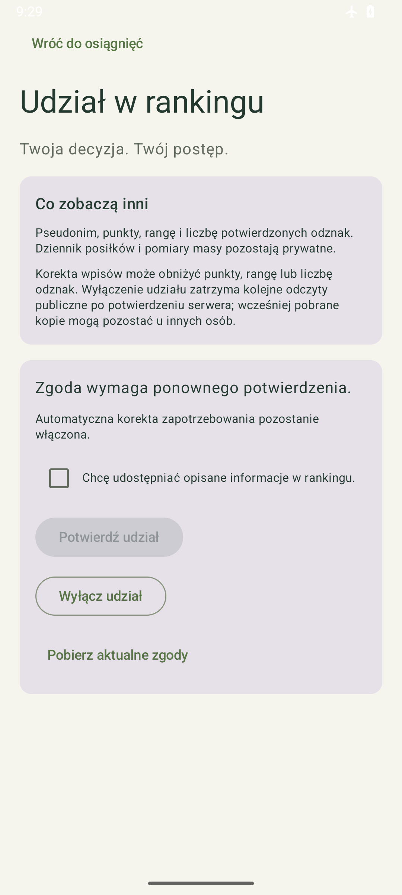
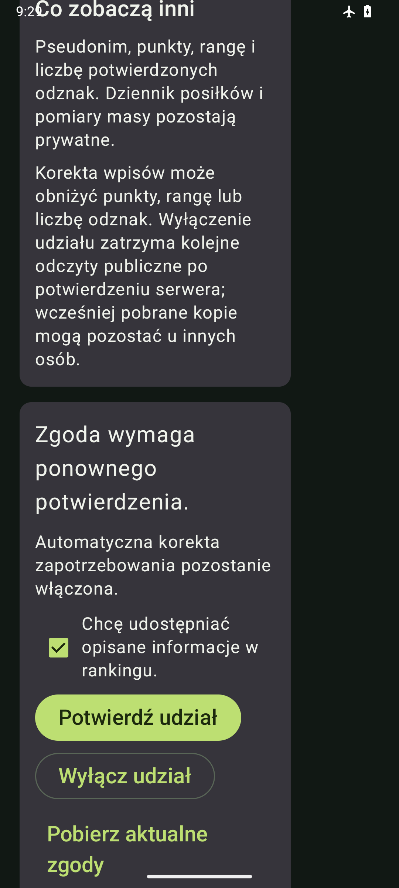

# Android 0.8.7 — świadomy udział w rankingu

13 października 2026, Agent 1. Gałąź `codex/android-ranking-zgody`.

Profil → Osiągnięcia → Udział w rankingu pozwala sprawdzić i świadomie zmienić udział. Odczyt, otwarcie ekranu i ponowne logowanie nie włączają publikacji. Krótsze podsumowanie i odznaki przed panelem serwera z 0.8.6 oraz zaakceptowane Postępy 0.8.4 pozostają zachowane.

## Zachowanie

- Ekran wyjaśnia publikację pseudonimu, punktów, rangi i liczby potwierdzonych odznak. Dziennik i pomiary masy pozostają prywatne; korekty mogą obniżyć wynik. Wyłączenie blokuje przyszłe odczyty po zatwierdzeniu serwera, ale nie obiecuje usunięcia kopii u innych użytkowników.
- „Pobierz aktualne zgody” odczytuje prywatny profil i motywację. Pokazuje odrębnie zgodę źródłową, aktualny udział oraz potrzebę ponownego potwierdzenia. Nowy odczyt resetuje zaznaczenie zgody; decyzja o włączeniu wymaga ręcznego zaznaczenia pola.
- PUT `/api/v1/me/consents` zachowuje źródłowe `automatic_energy_adjustment`. Wysyła pełne dwupolowe body, quoted `If-Match`, nowy UUID `Idempotency-Key` i bieżący `X-Ranking-Consent-Epoch` tylko przy włączeniu. Opt-out pomija ten nagłówek.
- Zatwierdzona operacja trafia do istniejącego szyfrowanego magazynu sesji przed wysłaniem. Odczyt z dysku weryfikuje jej trwałość. Utrata odpowiedzi pozwala wyłącznie świadomie ponowić identyczny klucz, body, revision i epoch, także po restarcie. Nie używa kolejki dziennika i nie ponawia się automatycznie.
- Konflikt wymaga nowego odczytu i nowej decyzji. Ścisły receipt i ETag potwierdzają konkretny zapis, nie obiecują aktualnego publicznego udziału po późniejszych zmianach. Ponowny odczyt sprawdza stan bieżący.
- Przed wysłaniem i po odpowiedzi kontrolowane są właściciel, lease, operacja, konto, generation, epoch i revision kontekstu. Wylogowanie, przełączenie A→B→A, odnowienie sesji i zewnętrzna zmiana powiązania Room usuwają nieaktualne podglądy. Stara operacja innego kontekstu nie jest ponawiana. Retry-After jest trwały i wspólny dla wywołań API.
- Gość bez skonfigurowanego API nadal korzysta z lokalnych odznak. Widzi wyjaśnienie i drogę do konta, bez fikcyjnych potwierdzeń lub punktów.

## Sprawdzenie

Źródło Androida: `8f37f7a65da97e8f0bf4ccf46978700a9075b5a0`. Wersja 0.8.7, versionCode 18, Room 8; bez migracji i zmian schematu.

| Zakres | Wynik i ograniczenia |
|---|---|
| Build, JVM, lint | Build PASS; 135 JVM PASS. Lint: 0 błędów, 4 wcześniejsze ostrzeżenia, 1 informacja. |
| Pierwsza próba JVM | 134/135; fixture JSONObject serializował Double 8.0 jako poprawny integer 8. Poprawiono wyłącznie wire fixture na literalne 8.0; odrzucanie niepoprawnego typu zachowane. Nieudany XML zachowany prywatnie. |
| Zmieniony przepływ przed ostatnim fencing profilu | 71/71 device PASS; nie jest dowodem późniejszej poprawki. |
| Pełna regresja po fencing profilu | 146/147 device, errors/skips 0. Jedyny błąd: test częściowej racji trwał 43889,591 s przez noc i po zmianie daty pytał o nowe LocalDate.now zamiast sprawdzać wcześniej wybrany dzień. Oryginalny XML zachowany. Pozostałe 146, w tym nowy observer profilu/kontekstu, PASS. |
| Po poprawce testu | Wszystkie 11 scenariuszy DiaryFlowTest PASS na finalnym źródle. Zmieniono wyłącznie datę oracle na przechwyconą przed interakcją; wymagania kcal, składników, ilości, recreation i IME zachowane. Zakresów nie sumujemy i nie nazywamy końcowym lokalnym pełnym 147 PASS. Zdalny CI wykona własną pełną regresję finalnego head. |
| Transport i protokół | 9 nowych JVM: dokładne body/nagłówki, kontrola przed pierwszym zapisem, no-store, redirect/bounds/compression/overload, strict UTF-8/JSON/receipt, klucz i trwały journal. To fake HTTPS, nie odbiór rzeczywistego serwera. |
| Sesja i UI | Zgoda wyłącznie jawna, lost ACK/restart, 409, 401/refresh, Retry-After, dublet, cancellation, logout/A→B→A, external context/epoch/generation, brak trwałego zapisu, malformed receipt/ETag i przeterminowany odczyt. UI jasny/ciemny, 320 dp/150% czcionki i nawigacja gościa. |
| Zainstalowana aplikacja | Rzeczywiste install-r i pierwszy launch zachowały wszystkie kolumny 22 tabel Room8 oraz FK według prywatnego baseline przed instalacją. Liczba posiłków jest w przekazaniu O1-023. Bez clear/uninstall; aplikacja otwarta na ekranie zgód rankingu. |

Syntetyczne podglądy z osobnego pakietu testowego, bez prywatnego dziennika:

## APK i próby ręczne

APK `Racje-i-kalorie-0.8.7-debug.apk`, SHA-256 `5234edbe64a73fb25813cdfcc7f94b074c17de73bc9244a7b9b8b4e923996772`, dostarczony lokalnie poza Git. Prywatne XML, bazy, sesje i zrzut rzeczywistego emulatora także pozostają poza repozytorium.

1. Profil → Osiągnięcia: krótkie podsumowanie, odznaki przed panelem serwera. Postępy zachowują dotychczasowy wygląd.
2. Udział w rankingu: przewiń opis publikacji i powrót do osiągnięć. Jako gość przejdź do konta i wróć; brak sieci nie blokuje dziennika.
3. Przy właściwie skonfigurowanym API/login/bootstrap pobierz zgody: sam odczyt niczego nie zmienia. Włączenie wymaga checkboxa, wyłączenie nie zmienia automatycznej korekty zapotrzebowania.
4. Utrata odpowiedzi/restart pozostawia tę samą zatwierdzoną decyzję do ponowienia. Konflikt prowadzi do świeżego odczytu, a wylogowanie lub zmiana kontekstu usuwa prywatne podglądy.

Punkty 3–4 mają obecnie dowody fixtures/transportu; własny rzeczywisty odbiór APK/API/OIDC/TLS pozostaje otwarty. Domyślny APK ma tryb gościa bez skonfigurowanego API. Nie zmieniono backendu, infrastruktury, kontraktów lub wymagań.

## Integracja i dalsza praca

PR41/0.8.6 scalono na ce8a326 po własnych ośmiu kontrolach PR. Oddzielny main CI38306484372 zakończył się failure: ECR data-limit przy pobieraniu PostgreSQL przed testami Keycloak; diagnozę przekazano O3 w O1-022. Późniejsze PR46/O3-015 przeniosły te same przypięte obrazy do Docker Hub. Historycznego failure nie zmieniamy na PASS.

Aktualna baza integracyjna: 83eab21894f37fedef488aaab32c8ec808f8162b. Odczytano nowy kontrakt wyników Nemesis, odbiór E8.5 i przekazania O3 dotyczące workerów, kopii, registry, upgrade i sesji po restore. To wyniki innych autorów; nie zamykają prób O1. Nemesis pozostaje domyślnie gated i wymaga osobnej aktywacji operatora.

Kolejne etapy O1: publiczna lista rankingu; pairing i wyniki Nemesis według aktualnego kontraktu; semantyczne E4/push/ACK/import i WorkManager oraz własny rzeczywisty odbiór API/APK/Room/cache. Jedyny dziennik: [komunikacja agentów](../docs/KOMUNIKACJA_AGENTOW.md).

Przed publikacją dołączono także PR49/main83eab21 zwykłym merge. O3-018 oraz pełny raport lokalnego rollout0014→0021 odczytane; Android/app identyczny z przetestowanym8f37. Dotychczasowy LAN adres nie istnieje na hoście, bramka używa loopback przy zachowanym issuer/certyfikacie. Operatorskie HTTPS PASS nie potwierdza osiągalności z APK. Potrzebny stabilny adres dla telefonu; brak wyjątków TLS lub zmiany tożsamości.

Publikacja O1-023: [PR50](https://github.com/Roseru/aplikacja-mobilna/pull/50), codex/android-ranking-zgody do main `83eab21894f37fedef488aaab32c8ec808f8162b`, pierwszy opublikowany head `71937d25c0a7ec03d3aad1e21eac7a5f351fd7fd`. PR bez draft, podpięty do rozmowy. Źródło Androida8f37 i APK5234edb pozostają bez zmian; zachowane22tabele/5posiłków, app0.8.7 otwarta na zgodach. E0 przed publikacją9schemas/95valid/35invalid/18scenarios/16vectors/5complete/72normalizations/523links PASS. Ten dopisek otrzymuje własny finalny head; osiem wymaganych kontroli będzie odczytane osobno. Zdalnego PASS/merge lub rzeczywistego API/APK/TLS nie deklarujemy.
