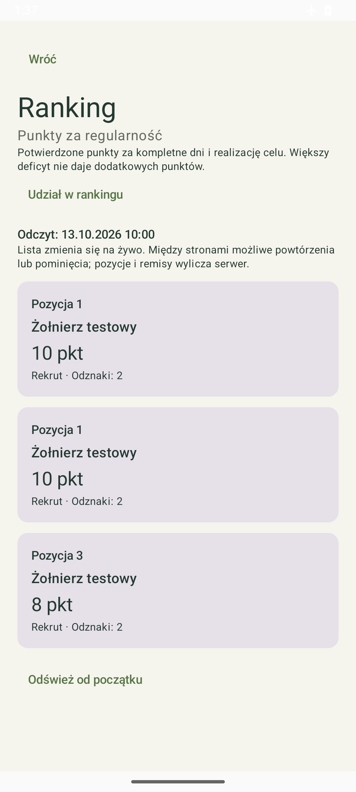
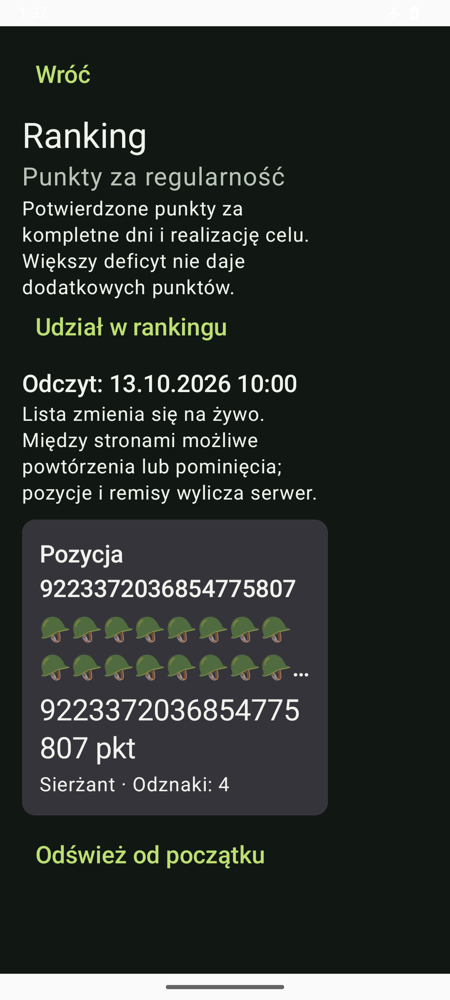

# Android 0.8.8 — lista rankingu

13 października 2026, Agent 1. Gałąź `codex/android-ranking-lista`, źródło końcowe `62602ddf1b8f17796e44175d7642839cdb40396f`, code19, Room8.

Profil → Osiągnięcia → Udział w rankingu → Zobacz ranking pokazuje potwierdzone pozycje, pseudonimy, punkty, rangi i liczbę aktywnych odznak. Krótsze podsumowanie, odznaki przed panelem serwera i zaakceptowane Postępy pozostają zachowane. Gość widzi wyjaśnienie i przejście do konta; jego dziennik działa offline.

## Odczyt i paginacja

- Ręczny GET `/api/v1/ranking?limit=25`, potem nieprzezroczysty `page_token`. Brak arbitralnego adresowania użytkownika, dodatkowego owner/points/rank lub nagłówków mutacji zgód. Otwarcie ekranu i odczyt nie włączają udziału.
- Każdą stronę poprzedza prywatny GET motywacji, porównujący generation/epoch z trwałym bootstrapem. Operacja i token sesji są kontrolowane przed fizyczną wysyłką i po odpowiedzi. Odczyt nie aktualizuje lokalnego profilu, celu lub dziennika i nie potwierdza kolejki.
- Jedna bieżąca strona w pamięci; bez dyskowego cache lub zapisywania obcych osób w Room. Pozycje i remisy pochodzą z serwera: 10,10,8 → 1,1,3. Pseudonimy mogą się powtarzać; klient nie wymyśla identyfikatorów i nie usuwa rzekomych duplikatów.
- Ranking jest na żywo. Przejście do kolejnej strony może pominąć lub powtórzyć osobę po zmianie danych. UI podaje czas odczytu. Nowa strona zaczyna się od góry; pusty fragment nie oznacza pustego całego rankingu.
- Utrata odpowiedzi oferuje ponowienie tego samego wejściowego tokenu. Lokalna data wygaśnięcia lub HTTP410 usuwa kontynuację i wymaga odświeżenia od początku; bez automatycznej pętli tworzenia sesji. HTTP429/503 respektuje wspólny trwały Retry-After, także po restarcie.
- Włączenie/wyłączenie rankingu pozostaje na osobnym ekranie zgód. Opuszczenie listy, zatrzymanie jej Activity, logout, nowe logowanie, zmiana lease/generation/epoch/context usuwają osoby i cursory. Spóźnione odpowiedzi nie przywracają podglądu.
- Ścisły DTO: UTF-8/JSON, znane pola/rule/pagination, integer64 bez float, liczba odznak0..4, Unicode pseudonim1..80, kolejność i spójność remisów/rangi, cursor i UTC timestamps. HTTP jest bounded/no-store, bez redirects/compression lub automatycznego retry.

## Walidacja

| Zakres | Wynik |
|---|---|
| Pierwszy pełny przebieg | Source92ace797fbedf6ee1c82d2a60cf44b50928bdfb2: build,144JVM,156device PASS, errors/failures/skips0. Lint0error4warning1info; pipeline23m47s, device533,531s. |
| Ostatnia poprawka zachowania UI | Po scroll-to-top i neutralnym pustym fragmencie: build/144JVM/lint i14 przypadków RankingScreenTest+DiaryFlowTest PASS; pipeline7m10s, device207,054s. Poprzedni156 jest oddzielnym dowodem, nie sumą170. |
| Fixture małego ekranu | Po uściśleniu wyłącznie fixture:3/3 RankingScreenTest PASS, pipeline1m33s, device43.794s. Dodano pomiar szerokości320dp i warstwę Box, aby minimalny rozmiar Surface nie nadpisywał ograniczenia. Wcześniejsze156/14 nie są dowodem tego pomiaru. Produkcyjny kod/APK bez zmian po tej korekcie. |
| Nowe JVM | 5 protocol +4 transport: remisy/powtarzające się pseudonimy, Long.MAX/deep positions/Unicode, typy/unknown fields/order/overflow, cursor/expiry/no-loop, URL/header/fence/no-store/redirect/overload/bounds. Wchodzą w144, nie są dodatkiem do tej sumy. |
| Nowe urządzenie | 6 SessionSecurity +3 Ranking UI wchodzą w156: explicit read, preflight, brak peer/cursor w vault, no diary/outbox mutation, retry tego samego tokenu, expiry/410, trwały429/restart,401once, physical-send/context oraz close/logout/A→B→A/generation. Nawigację gościa rozszerzono w istniejącym DiaryFlowTest. |
| Oryginalne RED innych etapów | PR50/ac CI147/1 oraz lokalna nocna data pozostają w raporcie0.8.7. Source36a3/test-only selektor: pełny135JVM/147device PASS. Nie przypisujemy tych wyników0.8.8 lub backendowi. |
| Zainstalowany APK | Rzeczywiste install-r, launch i kontrola po uruchomieniu zachowały wszystkie kolumny22tabel/Room8/5posiłków/FK według świeżego prywatnego baseline. Bez clear/uninstall. App0.8.8/code19 otwarta na rankingu; rzeczywisty ekran gościa nie zawiera fikcyjnych osób. |

Zakresów nie sumujemy. Finalny zdalny CI sprawdzi własny pełny zestaw na aktualnym head. Testy sesji/HTTPS używają fixtures; nie są rzeczywistym odbiorem API/OIDC/TLS lub całego E8.

## Podglądy i próby ręczne

Podglądy pochodzą wyłącznie z osobnego pakietu validation, bez prywatnego dziennika:

APK `Racje-i-kalorie-0.8.8-debug.apk`, SHA256 `11c708eaf2d6a781dca67298e83d135819caef0928669c0321c58c4d7492bb61`, lokalnie pozaGit. Rzeczywiste zrzuty emulatora, XML, vault i baseline także pozostają prywatne.

1. Przejdź z osiągnięć przez zgody do rankingu; jako gość otwórz konto i wróć. Postępy oraz zapisy offline pozostają dostępne.
2. Przy zgodnej konfiguracji API/PKCE/bootstrap pobierz ranking. Sam odczyt nie zmienia zgody; sprawdź pozycje, punkty i odznaki oraz czas odczytu.
3. Przejdź dalej, ponów utraconą odpowiedź, odśwież od początku i sprawdź wygaśnięcie. To live pages, bez gwarancji stałej globalnej listy.
4. Opuść ekran/zatrzymaj aplikację lub przełącz konto: stare osoby i cursor mają zniknąć. Spóźniona odpowiedź A nie może pojawić się uB.

Punkty2–4 mają obecnie własne dowody fixtures. Domyślny APK nie ma skonfigurowanego API; nie pokazuje fikcyjnych uczestników. O3 ma zapewnić stabilny osiągalny origin/issuer/publicCA; operatorski loopback nie jest dostępem telefonu.

## Publikacja i dalszy krok

[PR50](https://github.com/Roseru/aplikacja-mobilna/pull/50) scalony na2fc70f7ae612c031f63d53c04d3c81b4402b72c5 po świeżym guardzie b8b2a52/base6952c14,8success [CI38410300289](https://github.com/Roseru/aplikacja-mobilna/actions/runs/38410300289), reviews/inline0 i jednym przeczytanym komentarzuO2. To własny odbiór PR0.8.7; osobny pushmain i nowy PR0.8.8 mają własne kontrole. Listę rankingu kierujemy na main, bez stacku lub scalenia do oczekującego parent.

Odczytano scalony PR30/maina522471 i komentarz O2 w PR50, zapisano własne potwierdzenie oraz pierwszy scenariusz realnego klienta. Własny historyczny PR22 zamknięto jako zastąpiony; jego źródła/branch i plan pozostają dostępne, bez scalenia starego kodu lub nadpisania dawnych raportów.

Kolejny rezultat O1: pairing i wyniki Nemesis według odebranego E8.4/E8.5, osobne scopes, hidden/null/zero/signed metrics i privacy/session fences; dalej semantyczne E4/WorkManager/KO31 oraz recovery/KO32. Capability Nemesis i AI pozostają zamknięte do osobnego uprawnionego odbioru. [Jedyny dziennik](../docs/KOMUNIKACJA_AGENTOW.md).

Integracja końcowa O1-024: kod produkcyjny/APK11c708e pozostaje niezmieniony po main6952c14/O3 i mergePR50. Dołączono wszystkie12DiaryFlow O3+O1, bez utraty testedDay/ilości/IME/focus/no-write oraz własnego rank/account/back/recreate. Pierwsza próba15 miała14PASS/1FAIL: achievement-ranking zniknął po przewinięciu w trakcie przejścia lokalnegoLoading→Ready. XML zachowany prywatnie. Source62602dd dodaje oczekiwanie na achievement-count oraz displayed/enabled przed fizycznym kliknięciem; nie zwiększa timeoutu, nie usuwa asercji i nie ponawia ślepo. Pełne15zmienionych UI/nawigacjiPASS po poprawce, pipeline4m52s;144JVM/lint0error4warning1info wcześniejPASS przy tej integracji. To affected scope, nie lokalny pełny157 lub suma zestawów. RealAPI/OIDC/TLS i zdalny finalheadCI pozostają osobne.
