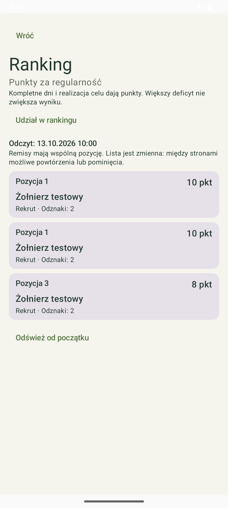
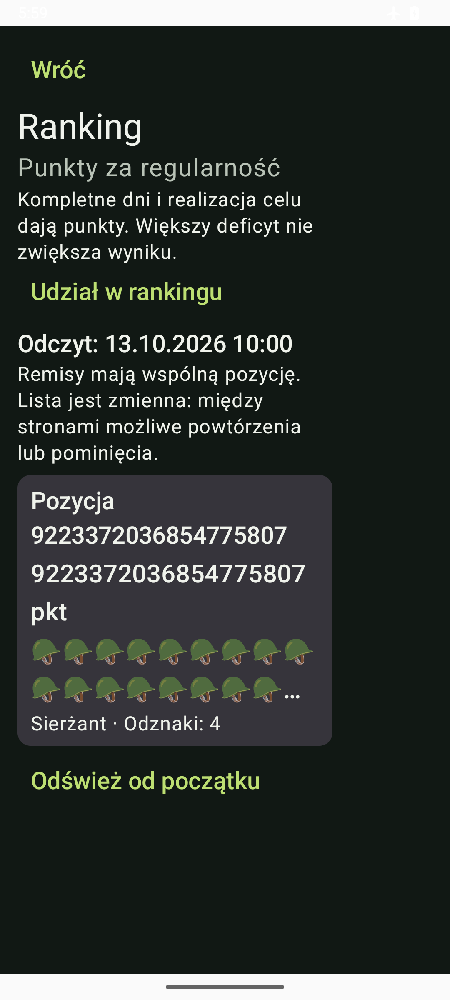

# Android 0.8.9 — gęstsza lista rankingu

Po decyzji właściciela „Zagęść listę” pozycja i punkty zajmują wspólny wiersz, pod nim są pseudonim oraz ranga z liczbą odznak. Mniejsze odstępy i marginesy pokazują więcej osób. Duża czcionka lub długie liczby zachowują osobne wiersze, bez ucinania wyniku. Mniejsze podsumowanie osiągnięć i zaakceptowany ekran Postępów pozostają zachowane.

Źródło Androida: `fcfc56f88003fe9ede620b4823ee760349fd6e98`, gałąź `codex/android-ranking-lista`, [PR55](https://github.com/Roseru/aplikacja-mobilna/pull/55). VersionCode20, Room8 bez migracji. APK poza Git: `Racje-i-kalorie-0.8.9-debug.apk`, SHA-256 `de3f0ee9326f750ed2800b2949fdc23e879e2c442b5e431e984e5220574d0c2a`.

## Przekazanie Agenta 2 i zgodność E9

Zwykłym merge395e14d dołączono main2b4073e z PR54/56. Konflikt obejmował wyłącznie dziennik; sprawdzenie zachowało wszystkie historyczne akapity obu rodziców oraz aktualne wiersze O2/O3.

Przeczytano O2-029/030, [przygotowanie odbioru APK/API](../docs/integracja/ODBIOR_APK_API_O2.md), [review zgód](../docs/integracja/RECENZJA_ZGOD_O2.md) oraz [kontrakt klienta E9](../docs/e9/INTEGRACJA_O1.md). Komunikat nie obiecuje już utrzymania aktywnego automatu po nowym PUT rankingu: zachowany jest boolean deklaracji, a osobna afirmacja jest wymagana. Nie zmieniono body zgód i nie dodano automatycznej afirmacji.

Naprawa dotyczy tekstu. Pełny klient E9 nadal wymaga GET energy/state z rozróżnieniem requested/effective, osobnego notice/affirm, osi E i dalszego odbioru API. Backendowy test Agenta 2 nie jest wynikiem Androida. Nemesis nadal wymaga klienta zaproszeń, akceptacji, odwołania i wyników; kontrakty lifecycle/statistics przeczytano przed implementacją.

## Wykonana weryfikacja

- Build APK i pełne144 JVM PASS; lint:0 błędów,4 istniejące ostrzeżenia,1 informacja.
-18 testów urządzenia PASS, errors/failures/skipped0: RankingScreenTest3, RankingConsentScreenTest3, DiaryFlowTest12. Czas urządzenia:244.054s. Test sprawdza standardowy wiersz≤100dp, pozycje remisowe, punkty/rangę/odznaki,320dp/font150%, long counts, zgodę początkowo wyłączoną oraz fizyczną nawigację.
- Install-r, pierwsze uruchomienie i porównanie baseline zachowały wszystkie kolumny22tabel,5posiłków, kolejkę/archiwum i poprawne foreign keys. Bez clear/uninstall.
- Wcześniejszy finalny head243f427/0.8.8 miał8 success w [CI38413705775](https://github.com/Roseru/aplikacja-mobilna/actions/runs/38413705775). Log android-device potwierdza157/157, failures/skipped0. To dowód poprzednich źródeł, nie nowego head0.8.9.
- E0 i zdalne CI nowej publikacji są odrębnymi kontrolami. Zakresy testów nie są sumowane; lokalne18 nie stanowi nowego pełnego157.

## Podglądy i test manualny

Podglądy zawierają wyłącznie syntetycznych uczestników aplikacji validation:

Aplikacja produkcyjna jest otwarta na rankingu. Bez skonfigurowanego serwera pokazuje stan konta/połączenia; przykładowe osoby nie są wpisywane do dziennika ani prezentowane jako rzeczywisty ranking. Świeży odczyt, kolejne strony, retry i czyszczenie podglądu pozostają zgodne z0.8.8.

Rzeczywisty APK/API/OIDC/TLS czeka na osiągalny origin/issuer/publicCA od O3. Następny etap O1: Nemesis, następnie semantyczneE4/WorkManager/KO31/recovery oraz klientE9. CI i fixtures nie zamykają tych odbiorów.

Końcowy odbiór O1-025: E0 PASS —10 schemas,95 valid/35 invalid,18 scenariuszy,16 Decimal vectors,5 kompletności,72 normalizacje,580 lokalnych linków; diff-check PASS. Pierwszy prywatny helper otwierania ekranu zakończył FAIL przy nakładającej się nawigacji (błąd kolejności działań O1, bez zmiany kodu lub dziennika). Drugi helper potwierdził ekran rankingu; installed package ma versionCode20/versionName0.8.9. Nie ponawiano testów18 lub CI bez zmiany. Baseline, XML i prywatny zrzut pozostają pozaGit. Źródła zostały zapisane wfcfc56f88003fe9ede620b4823ee760349fd6e98, main przed publikacją nadal2b4073e05d800fe3abc2388c17308323adf5ed56. Aktualizujemy istniejący PR55, bez nowego duplikatu. Końcowy head i jego8CI są osobną bramką.
