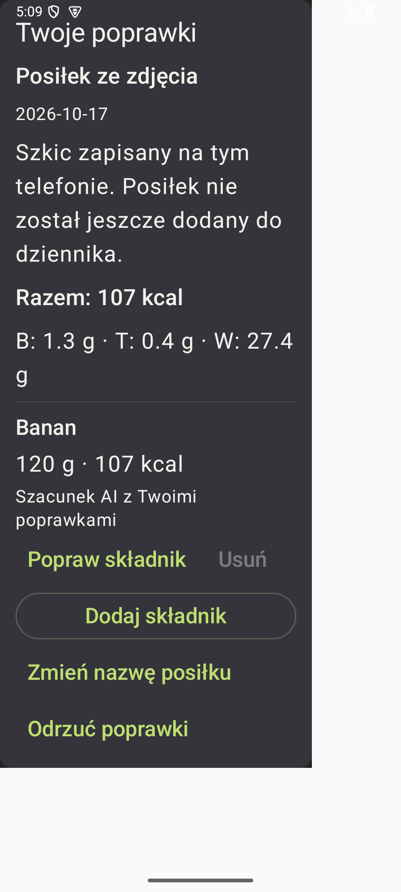

# Poprawki posiłku — 0.8.18

Syntetyczny podgląd komponentu z testowego APK validation1029, kod
`6e1eac8128de2a2036878de380c19817c369dbb5`, API35. Kolumna320dp,
czcionka150%, ciemny motyw; jasny obszar poza kolumną to host testu.
To odczyt istniejącego szkicu przed potwierdzeniem: banan120g/107kcal.
Callback edycji sprawdzany w tym teście nie podmienia rodzica prezentacji;
trwały zapis i ponowne odczytanie sprawdzają osobne testy Session/Room.

Pełne245/245 native i dodatkowe3/3 Compose zaliczone. Pierwsze zrzuty
zasłaniało okno ANR SystemUI, zachowane lokalnie jako diagnostyka.
Po wybraniu rzeczywiście odczytanego przycisku Wait powtórzono tylko3testy
wyglądu. Panel obejrzano bez nakładki. Drugi plik, nazwany przez test dialogiem,
uchwycił również panel: **nie został opublikowany jako dowód wyglądu dialogu**.
Zachowujemy ten brak osobno od zaliczonych asercji edycji, walidacji i lifecycle.
Nie ma prywatnych posiłków, danych kont ani obrazu użytkownika.
