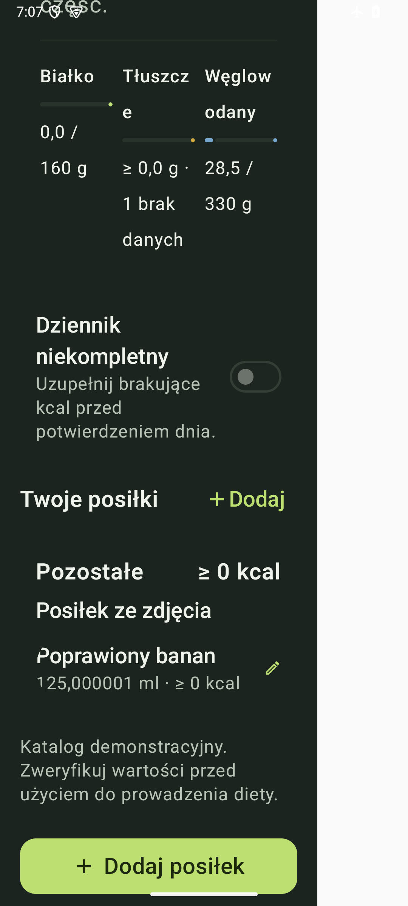
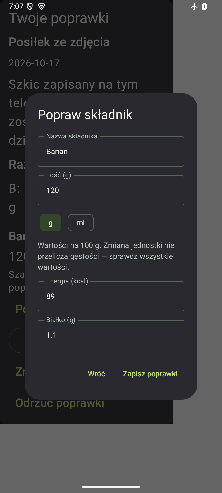

# Dziennik i dialog poprawek — 0.8.19

Rzeczywiste zrzuty syntetycznych testów APK validation1030, API35,
kolumna320dp i czcionka150%, ciemny motyw. Kod `97fff241bfbaaa1b5e59bd393d3ebac1ce95ddaf`.
Jasny lub szary obszar obok komponentu należy do hosta testowego.

## Dziennik

Widok pokazuje nazwę posiłku, grupę Pozostałe dla nieokreślonego typu oraz
ilość125,000001ml zapisaną przez rzeczywistą edycję w osobnej bazie Room.
Sztuczna nazwa składnika i jednostka ml służą sprawdzeniu formatowania;
wartości nie opisują rzeczywistego produktu. Brak energii pozostaje niepełny,
co pokazują ≥0kcal i wyłączona deklaracja kompletności. Zero białka jest jawne.
Nie utworzono fikcyjnej referencji produktu lub wpisu w katalogu.

## Dialog poprawek

To faktyczny dialog z przewijanymi polami, wyborem g/ml i dostępnym przyciskiem
zapisu. Zsynchronizowano stan Compose/main przed zrzutem. Uzupełnia to brakujący
podgląd z0.8.18; dawnych plików diagnostycznych nie zastąpiono nowym obrazem.
Oba zrzuty obejrzano bez nakładki SystemUI. Nie zawierają historii lub zdjęć
użytkownika i nie są dowodem wywołania Gemini lub rzeczywistego API.
